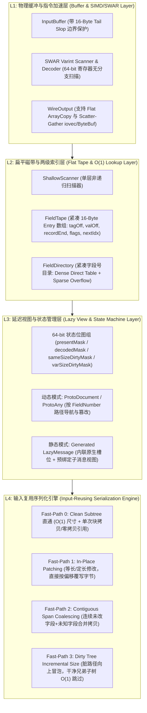
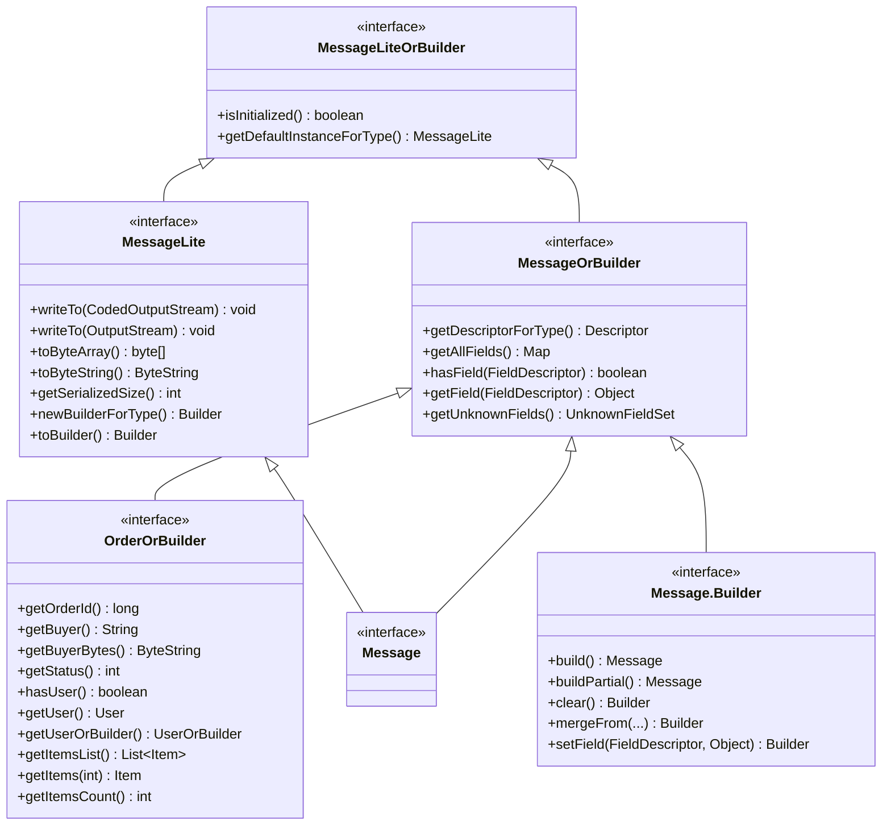

# Lazy-Proto 深度架构与跨语言性能设计文档

> **项目定位**：一个性能优先（Performance-First）的 Protocol Buffers 操纵引擎与代码生成框架。  
> **核心思想**：借鉴 `json-iterator` (`jsoniter`) 的 `LazyAny` / Tape 延迟解析思想，结合 `LightProto` / `ProtoZero` / `simdjson` 的底层内存布局，实现 **按需延迟反序列化（Lazy Deserialization）** 与 **最大化复用输入的拼接式序列化（Input-Reusing Splicing Serialization）**。  
> **设计取舍**：主动舍弃标准 Protobuf 中拖累性能与阻碍 Lazy 化的接口（如 `equals`、`hashCode`、`Builder` 双对象体系、通用反射 `Descriptor`、强不可变性），换取接近物理内存带宽极限的吞吐量。

---

## 目录

1. [背景与核心性能模型](#1-背景与核心性能模型)
2. [业界方案深度对比](#2-业界方案深度对比)
3. [全局四层架构设计](#3-全局四层架构设计)
4. [底层核心数据结构与位级内存布局](#4-底层核心数据结构与位级内存布局)
5. [Lazy 反序列化引擎：SWAR 算法与三级延迟机制](#5-lazy-反序列化引擎swar-算法与三级延迟机制)
6. [复用输入的序列化引擎：四级加速路径与算法伪代码](#6-复用输入的序列化引擎四级加速路径与算法伪代码)
7. [全过程字节级推演示例（Byte-by-Byte Walkthrough）](#7-全过程字节级推演示例byte-by-byte-walkthrough)
8. [不同编程语言对性能的影响与针对性架构设计（C++ / Rust / Go / Java）](#8-不同编程语言对性能的影响与针对性架构设计c--rust--go--java)
9. [Java 版深度实现与 `protobuf-java` 接口兼容架构（受控异常裁剪方案）](#9-java-版深度实现与-protobuf-java-接口兼容架构受控异常裁剪方案)
10. [关键边界与 Protobuf Wire 语义完备性](#10-关键边界与-protobuf-wire-语义完备性)
11. [模块划分与分阶段实施路线图](#11-模块划分与分阶段实施路线图)

---

## 1. 背景与核心性能模型

### 1.1 真实生产负载的“二八定律”
在网关路由、RPC 代理、流式日志处理、特征工程管道以及微服务通信中，绝大多数业务对 Protobuf 消息的操作属于 **Read-Few, Modify-Few, Passthrough-Most**：

- **场景 A（只读路由/过滤）**：接收 32KB 的消息，仅读取顶层 `trace_id`、`tenant_id` 和子消息中的 `region`，随后丢弃或原样转发。
- **场景 B（局部修改/打标）**：读取 2 个字段后，修改 1 个状态码（如 `status = 2`）、更新 1 个时间戳或向 `repeated` 列表追加 1 个节点，再序列化发往下游。
- **场景 C（脱敏/裁剪）**：删除 1~2 个大字段或敏感字段，其余几十个已知与未知字段（Unknown Fields）原样输出。

### 1.2 传统反序列化-再序列化的代价公式

设消息总字节数为 $B$，总字段数（含嵌套）为 $N$，实际业务读取字段数为 $R$（$R \ll N$），实际修改字段数为 $W$（$W \ll N$）：

- **官方 Protobuf 开销**：
  $$T_{\text{official}} = \underbrace{O(B) + O(N) \cdot C_{\text{alloc}}}_{\text{全树递归反序列化 + 堆分配}} + \underbrace{O(N) \cdot C_{\text{size}}}_{\text{全树尺寸重算}} + \underbrace{O(B) + O(N) \cdot C_{\text{encode}}}_{\text{全树逐字段重编码与 UTF-8 转换}}$$
- **`lazy-proto` 目标开销**：
  $$T_{\text{lazy-proto}} = \underbrace{O(K_{\text{top}})}_{\text{仅访问层Tag跳跃}} + \underbrace{O(R) \cdot C_{\text{decode}}}_{\text{仅解码读取的 } R \text{ 个字段}} + \underbrace{O(W) \cdot C_{\text{encode}}}_{\text{仅重编码修改的 } W \text{ 个字段}} + \underbrace{O(S) \cdot C_{\text{memcpy}}}_{S \le W+1 \text{ 段连续原始内存块复制}}$$

当 $W = 0$（未修改）时，序列化退化为 $1$ 次 `memcpy`（或零拷贝切片引用），计算尺寸耗时严格为 $O(1)$；当 $W = 1$ 且编码后字节长度未变时，序列化退化为 $O(1)$ 原地字节覆写（In-Place Patching）。

---

## 2. 业界方案深度对比

| 维度 | Google Protobuf | `json-iterator` (`jsoniter`) | StreamNative `LightProto` | Perfetto `ProtoZero` | **`lazy-proto`（本项目）** |
| :--- | :--- | :--- | :--- | :--- | :--- |
| **跳过未读子树复杂度** | ❌ 不跳过，全量递归解析 | $O(N_{\text{bytes}})$（需扫描引号转义与 `{}` 括号深度） | $O(1)$（利用 WireType 2 长度跳过子消息） | $O(1)$（流式游标跳过） | **$O(1)$（WireType 2 长度跳过 + SWAR 快速跳过 Varint）** |
| **扫描阶段堆分配** | 极高（SubMessage / List / String / UnknownFieldSet） | 低（按路径懒创建 `LazyAny`） | 零（依赖预生成可变类） | 零（无状态迭代器） | **零（扁平 `FieldTape` 原生数组 + 位图索引）** |
| **已读但未改字段的序列化** | 重新计算尺寸 + 重新编码（如 `String -> UTF-8`） | 重新序列化整个对象 | 标量与已打开的子消息需重新编码 | 手动控制 | **100% 复用原输入 `[tagOffset, recordEnd)` 切片，绝不重编码** |
| **同层未修改兄弟字段合并** | ❌ 逐字段写 Tag + Value | ❌ 逐字段写 | ❌ 逐字段写 Tag + Value | ❌ 手动切片 | **✅ Contiguous Span Splicing（多个相邻未改字段合并为单次 `memcpy`/`iovec`）** |
| **定长/等长字段修改优化** | ❌ 全树重算 `SerializedSize` | ❌ 重新生成 | ❌ 重算父链 `SerializedSize` | ❌ 不支持就地修改 | **✅ In-Place Binary Patching（直接在原 `valueOffset` 覆写，免重算父消息长度）** |
| **动态访问 + 静态生成双支持** | 静态类 + 慢速 `DynamicMessage` | ✅ `Any` 动态 API + 静态绑定 | 仅静态代码生成 | 仅底层流式读写器 | **✅ 共享同一 `FieldTape` 的动态 `ProtoDocument` 与静态 `LazyMessage`** |

---

## 3. 全局四层架构设计



---

## 4. 底层核心数据结构与位级内存布局

### 4.1 扁平字段磁带条目（128-bit / 16-Byte `TapeEntry`）

每当 `ShallowScanner` 扫描一层消息时，不会创建任何 `Field` 对象，而是向一块预分配/可复用的连续内存 `FieldTape` 追加 16 字节（或两个 `uint64_t` / `long`）的 `TapeEntry`。4 个 `TapeEntry` 恰好填满一条 64-Byte CPU Cache Line：

```text
TapeEntry (128 bits = 2 x 64-bit Words):
┌───────────────────────────────────────┬───────────────────────────────────────┐
│ Word 0 [63..32]: tagOffset (uint32)   │ Word 0 [31..0]: recordEnd (uint32)    │
├──────────────────────┬────────┬───────┼───────────────────────────────────────┤
│ Word 1 [63..35]:     │ [34..32│[31..28│ Word 1 [27..24]: │ Word 1 [23..0]:    │
│ fieldNumber (29-bit) │wireType│ flags │ headerLen (4-bit)│ nextTapeIdx(24-bit)│
└──────────────────────┴────────┴───────┴──────────────────┴────────────────────┘
```

#### 字段精确定义与巧妙之处：
1. **`tagOffset` (32-bit)**：该字段的 Tag Varint 在输入缓冲区中的起始偏移（支持单消息最大 4GB）。
2. **`recordEnd` (32-bit)**：该字段净荷（Value）结束后的下一个字节偏移。
   - **完整原始字节区间** = `[tagOffset, recordEnd)`，总长度 = `recordEnd - tagOffset`。
3. **`headerLen` (4-bit, `0..15`)**：`valueOffset - tagOffset`，即 `Tag Varint` +（可选的 `Length Varint`）占用的字节数。
   - 因为 Tag Varint 最多 5 字节，Length Varint 最多 5 字节，两者之和恒 $\le 10 < 15$！
   - 因此，**无需浪费一个 32-bit 整数存储 `valueOffset`**，通过 `valueOffset = tagOffset + headerLen` 即可在 1 个指令周期内算出净荷起始位置，同时算出净荷长度 `valueLen = recordEnd - valueOffset`！
4. **`wireType` (3-bit, `0..5`)**：`0=Varint, 1=Fixed64, 2=LengthDelimited, 5=Fixed32`。
5. **`flags` (4-bit 状态位)**：
   - `0000 (CLEAN_RAW)`：原始未修改（可能已读并缓存，但值未变）。
   - `0001 (DIRTY_SAME_SIZE)`：值被修改，但新编码长度与原净荷长度 `valueLen` **完全相等**（可走原地覆写 Fast-Path 1）。
   - `0010 (DIRTY_VAR_SIZE)`：值被修改且编码长度发生变化，或子消息内部发生了变长修改。
   - `0011 (DELETED)`：被用户显式调用 `clearXxx()` / `remove()` 删除。
   - `0100 (SHADOWED)`：同一个非 `repeated` 标量字段在原始输入流后面再次出现，导致当前旧条目被覆盖失效。
6. **`nextTapeIdx` (24-bit, 最大支持单层 1600 万个条目)**：
   - 对于 `repeated` 字段（或分段传输的同名子消息），指向下一个具有相同 `fieldNumber` 的 `TapeEntry` 下标（`0xFFFFFF` 表示链表尾 `NULL`）。**完全用数组下标静态单链表替代了 `ArrayList`！**

### 4.2 O(1) 字段查找目录（`FieldDirectory`）

当用户调用 `msg.getField(fieldNumber)` 时，如何避免遍历 `FieldTape`？

- **静态代码生成模式（Generated `LazyMessage`）**：
  - 编译器已知 `.proto` 中定义的所有字段号。代码生成器将每个字段映射为编译期常量密集下标 `SLOT_0, SLOT_1, ..., SLOT_K`，类中持有一个定长原生数组 `int[] slotToTapeIdx`（对于 `repeated` 字段则额外记录 `slotToTailTapeIdx` 和 `slotCount`）。
  - 查找复杂度：严格的 **$O(1)$ 数组寻址（1 次内存读取）**。
- **动态模式（`ProtoDocument`）**：
  - 采用 **“小字段号直达表 + 开放寻址溢出表”** 混合结构：
    - 95% 以上的 Protobuf 字段号在 `1..64` 之间：内置 `int directMap[65]`，字段号 `1..64` 直接 $O(1)$ 查表；
    - 字段号 `> 64`：落入一个紧凑的 2 的幂次大小线性探测哈希数组 `long[] sparseMap`。
  - 重置开销：维护一个 `presentMask64` 位图，重置 `directMap` 时无需 `memset` 整个数组，仅需按位清除置位过的槽位或递增 `epoch` 版本号！

### 4.3 64-Bit 状态位图加速器（Bitmask Acceleration）

对于字段数 $\le 64$ 的绝大多数消息（超过 64 个字段时自动扩展为 `long[]`），单个消息实例仅用 4 个 64-bit 寄存器字（32 字节）即可掌控全局状态：

```text
1. presentMask       : bit i == 1 表示字段 i 在输入流中存在或已被设置
2. decodedMask       : bit i == 1 表示字段 i 已从 Tape 解码到当前对象的成员变量缓存中
3. sameSizeDirtyMask : bit i == 1 表示字段 i 被修改，但字节长度与原输入完全一致
4. varSizeDirtyMask  : bit i == 1 表示字段 i 被变长修改、新增、删除，或子消息长度改变
```

依靠这 4 个位图，序列化前的路径分派只需 **两条 CPU 位运算指令**：
- **是否完全未修改（Fast-Path 0）？**  
  `if ((sameSizeDirtyMask | varSizeDirtyMask) == 0)` -> 直接整块输出原始切片！
- **是否可走原地覆写（Fast-Path 1）？**  
  `if (varSizeDirtyMask == 0 && sameSizeDirtyMask != 0)` -> 直接利用 `tzcnt` (`numberOfTrailingZeros`) 遍历 `sameSizeDirtyMask` 中为 1 的 bit，定位到对应 `valueOffset` 原地覆写即可！

---

## 5. Lazy 反序列化引擎：SWAR 算法与三级延迟机制

### 5.1 SWAR (SIMD Within A Register) 无分支 Varint 跳过与解码

在 Tier 1 浅扫描（`ShallowScanner`）中，唯一需要扫描字节内容的 Wire Type 是 `WT_VARINT (0)` 以及所有字段头部的 `Tag` 和 `Length`。传统逐字节 `while ((buf[p++] & 0x80) != 0)` 循环存在严重的分支预测失败（Branch Misprediction）和数组越界检查开销。

`lazy-proto` 采用 **64-bit 寄存器级并行位扫描（SWAR）**：

#### 算法：1 条指令计算 Varint 长度并跳过
只要剩余缓冲区长度 $\ge 10$ 字节（或输入缓冲区尾部预留 16 字节 Slop Padding）：

```c
// 1. 一次性非对齐读取 8 字节 (Little-Endian)
uint64_t word;
memcpy(&word, buf + cursor, 8);

// 2. 提取每个字节的最高位 (MSB, 0x80)：
// 对 word 取反后与 0x8080808080808080ULL 相与。
// 原字节最高位为 0（即 Varint 结束字节）的位置，对应 bit 7 会变成 1！
uint64_t term_mask = ~word & 0x8080808080808080ULL;

// 3. 使用硬件指令 TZCNT (Count Trailing Zeros) 直接算出第一个结束字节的偏移！
// 若 term_mask != 0（99.99% 的 Varint <= 8 字节，包括所有 32位整数和绝大多数 64位整数）：
int varint_byte_len = (__builtin_ctzll(term_mask) >> 3) + 1;
cursor += varint_byte_len; // 零循环、零分支直接跳过该 Varint！
```

- **性能对比**：传统循环跳过一个 5 字节 Varint 需要 5 次字节加载 + 5 次条件跳转；SWAR 方法仅需 **1 次 64-bit 加载 + 1 次按位与非 + 1 条 `tzcnt` 指令**，彻底消除分支预测惩罚！
- **Tag 快速解析**：绝大多数 Protobuf Tag 只有 **1 字节**（字段号 `1..15`，因为 `(15 << 3) | 7 = 127 < 0x80`）或 **2 字节**（字段号 `16..2047`）。因此 `ShallowScanner` 对 Tag 采用 `if ((b0 & 0x80) == 0)` 的 1 字节极速热路径，次热路径走 2 字节判断，其余走 SWAR。

### 5.2 ShallowScanner 单层浅扫描完整流程

```text
输入: ByteSlice (buf, rawOffset, rawLength)
输出: 填充当前消息的 FieldTape 与 FieldDirectory (绝不递归子消息)

cursor = rawOffset
end = rawOffset + rawLength

while cursor < end:
    tagOffset = cursor
    tag = readTagFast(buf, &cursor)
    fieldNum = tag >>> 3
    wireType = tag & 7

    switch wireType:
        case 0 (VARINT):
            valOffset = cursor
            skipVarintSWAR(buf, &cursor)
            recordEnd = cursor
        case 1 (FIXED64):
            valOffset = cursor
            cursor += 8
            recordEnd = cursor
        case 2 (LEN_DELIMITED): // String, Bytes, SubMessage, Packed Repeated
            len = readVarint32SWAR(buf, &cursor)
            valOffset = cursor
            cursor += len       // <--- O(1) 跨越整个子消息或长字符串！
            recordEnd = cursor
        case 5 (FIXED32):
            valOffset = cursor
            cursor += 4
            recordEnd = cursor

    headerLen = valOffset - tagOffset
    appendTapeEntry(fieldNum, wireType, tagOffset, recordEnd, headerLen)
```

---

## 6. 复用输入的序列化引擎：四级加速路径与算法伪代码

这是 `lazy-proto` 的核心竞争力。我们确保：**任何未被修改的字节，都绝不重新经过编码器**。

### 6.1 四级序列化路径决策树

```text
                       ┌──────────────────────────┐
                       │   serialize(LazyMessage) │
                       └────────────┬─────────────┘
                                    │
                   ┌────────────────┴────────────────┐
                   ▼ (Dirty == 0)                    ▼ (Dirty != 0)
        ┌─────────────────────┐           ┌──────────────────────┐
        │   Fast-Path 0       │           │ varSizeDirtyMask==0? │
        │ 100% 原始切片直通    │           └──────────┬───────────┘
        │ O(1) memcpy / iovec │                      │
        └─────────────────────┘           ┌──────────┴───────────┐
                                          ▼ (Yes)                ▼ (No)
                               ┌─────────────────────┐ ┌─────────────────────────┐
                               │    Fast-Path 1      │ │   Fast-Path 2 & 3       │
                               │ 原地字节修补 (Patch) │ │ 连续区间合并拼接 +       │
                               │ 免重算父级消息长度   │ │ 脏子树增量尺寸重算       │
                               └─────────────────────┘ └─────────────────────────┘
```

### 6.2 Fast-Path 1：跨层级同长原地修补（Deep In-Place Patching）

当业务修改某个字段 `msg.getSubA().getSubB().setStatus(newStatus)` 时：
1. 若 `status` 原先存在于 `SubB` 的 `FieldTape` 中，记原净荷区间为 `[valOff, recordEnd)`，原长度 `oldLen = recordEnd - valOff`。
2. 计算 `newStatus` 的 Varint 编码长度 `newLen = varintSize(newStatus)`。
3. **关键判定**：若 `newLen == oldLen`（对于 `fixed32`/`fixed64`/`float`/`double`/`bool`，该条件 **100% 永远成立**；对于状态码枚举、同位数 ID 字符串也极常成立）：
   - `SubB` 仅置位 `sameSizeDirtyMask |= BIT_STATUS`（不置位 `varSizeDirtyMask`）。
   - 向父节点 `SubA` 和 `Root` 报告 `CHILD_SAME_SIZE_DIRTY`。
   - **注意**：`SubB` 的总长度没变 $\implies$ `SubA` 中包裹 `SubB` 的 Length Varint 没变 $\implies$ `Root` 中包裹 `SubA` 的 Length Varint 也没变！
4. 当在 `Root` 上调用 `toByteArray()` 时：
   - 先执行一次整包拷贝：`byte[] out = Arrays.copyOfRange(buf, rawOffset, rawOffset + rawLength);`（若原地修改模式 `wrapMutable` 则连这步拷贝都省去）。
   - 顺着 `sameSizeDirtyMask` 直接在 `out[valOff - rawOffset]` 处覆写 `newStatus` 的字节！
   - **耗时**：与消息有多少个字段、嵌套多少层完全无关，恒为 $O(1)$ 编码！

### 6.3 Fast-Path 2 & 3：连续原始区间合并拼接算法（Contiguous Span Coalescing）

当存在变长修改（`varSizeDirtyMask != 0`）、字段删除或新增字段时，执行 **两阶段区间拼接算法**：

#### 阶段一：增量尺寸计算（`computeSerializedSize()`）
```python
def computeSerializedSize(msg) -> int:
    # 1. 若当前节点或子树完全未发生变长修改，直接 O(1) 返回原始长度！
    if msg.scanned == False or msg.varSizeDirtyMask == 0:
        msg.cachedSize = msg.rawLength
        return msg.rawLength

    totalSize = 0
    # 2. 遍历当前层 FieldTape
    for entry in msg.tape:
        if entry.flags == CLEAN_RAW:
            # 连同原始 Tag + Length + Value 的总字节数直接相加，O(1)
            totalSize += (entry.recordEnd - entry.tagOffset)
        elif entry.flags == DIRTY_SAME_SIZE:
            totalSize += (entry.recordEnd - entry.tagOffset)
        elif entry.flags == DELETED or entry.flags == SHADOWED:
            continue # 被删除或被后文覆盖的旧字段，占 0 字节
        elif entry.flags == DIRTY_VAR_SIZE:
            if entry.isSubMessage():
                child = msg.getLoadedChild(entry.fieldNumber)
                childBodySize = computeSerializedSize(child) # 仅递归脏子树
                totalSize += tagSize(entry.fieldNumber) + varintSize(childBodySize) + childBodySize
            else:
                totalSize += tagSize(entry.fieldNumber) + msg.computeDirtyScalarOrStringSize(entry)

    # 3. 加上原本不在 Tape 中、新追加(Appended)的字段尺寸
    for newField in msg.appendedFields:
        totalSize += computeNewFieldSize(newField)

    msg.cachedSize = totalSize
    return totalSize
```

#### 阶段二：连续区间合并写出（`writeSplicedTo(WireOutput out)`）
```python
def writeSplicedTo(msg, out: WireOutput):
    if msg.scanned == False or (msg.varSizeDirtyMask == 0 and msg.sameSizeDirtyMask == 0):
        # Fast-Path 0: 整个消息或干净子消息单次整块拷贝
        out.writeRawBytes(msg.buf, msg.rawOffset, msg.rawLength)
        return

    # 维护当前正在累积的连续原始字节区间 [spanStart, spanEnd)
    spanStart = -1
    spanEnd = -1

    for entry in msg.tape:
        if entry.flags == CLEAN_RAW:
            if spanStart == -1:
                spanStart = entry.tagOffset
                spanEnd = entry.recordEnd
            elif spanEnd == entry.tagOffset:
                # 物理相邻！直接向右吞并扩展连续区间，零拷贝开销！
                spanEnd = entry.recordEnd
            else:
                # 刷新前一段连续区间
                out.writeRawBytes(msg.buf, spanStart, spanEnd - spanStart)
                spanStart = entry.tagOffset
                spanEnd = entry.recordEnd

        elif entry.flags == DELETED or entry.flags == SHADOWED:
            # 遇到删除字段，先刷出前面累积的干净区间，然后跳过当前条目
            if spanStart != -1:
                out.writeRawBytes(msg.buf, spanStart, spanEnd - spanStart)
                spanStart = -1

        elif entry.flags in (DIRTY_SAME_SIZE, DIRTY_VAR_SIZE):
            # 遇到脏字段，先刷出前面累积的干净区间
            if spanStart != -1:
                out.writeRawBytes(msg.buf, spanStart, spanEnd - spanStart)
                spanStart = -1
            # 仅对该脏字段执行重新编码（若是脏子消息则递归调用 writeSplicedTo）
            encodeDirtyEntry(msg, entry, out)

    # 刷出尾部剩余的连续干净区间
    if spanStart != -1:
        out.writeRawBytes(msg.buf, spanStart, spanEnd - spanStart)

    # 写出尾部新增字段
    for newField in msg.appendedFields:
        encodeNewField(msg, newField, out)
```

> [!TIP]
> **看看这个区间合并算法的威力**：  
> 假设一个消息有 50 个字段（按顺序排列为 `F1..F50`），用户只修改了第 25 个字段 `F25`。  
> `writeSplicedTo` 在循环时：
> - `F1..F24` 会通过 `spanEnd = entry.recordEnd` 被无缝合并为 **第 1 个连续区间 `[F1.tagOffset, F24.recordEnd)`**，仅触发 **1 次 `memcpy`**！
> - 重新编码写入 `F25`！
> - `F26..F50` 会被无缝合并为 **第 2 个连续区间 `[F26.tagOffset, F50.recordEnd)`**，仅触发 **1 次 `memcpy`**！
> 无论那 49 个未修改字段里有多少个复杂的嵌套对象、长字符串、数组或 Unknown Fields，它们全部在 **2 次 `memcpy`** 中完成了序列化！

---

## 7. 全过程字节级推演示例（Byte-by-Byte Walkthrough）

为了直观验证设计，我们用一条真实的 Protobuf 消息进行字节级推演：

```protobuf
message Order {
  int64  order_id = 1; // Tag: 0x08 (field=1, wt=0)
  string buyer    = 2; // Tag: 0x12 (field=2, wt=2)
  int32  status   = 3; // Tag: 0x18 (field=3, wt=0)
  bytes  payload  = 4; // Tag: 0x22 (field=4, wt=2) - 假设为 1000 字节的二进制负载
}
```

### 7.1 原始输入字节流（共 1014 字节）
```text
Offset:  [0]   [1..2]      [3]   [4]   [5..9]          [10]  [11]  [12]  [13..14]  [15..1014]
Bytes :  0x08  0xE8 0x07   0x12  0x05  "alice"         0x18  0x01  0x22  0xE8 0x07 <1000 bytes>
含义  :  Tag1  val=1000    Tag2  len=5 val="alice"     Tag3  val=1 Tag4  len=1000  payload净荷
```

### 7.2 执行过程
1. **`order.wrap(buf, 0, 1014)`**：仅记录偏移，耗时 0。
2. **业务调用 `order.getOrderId()`**：
   - 触发 `ShallowScanner` 扫描 4 个 Tag，生成 4 条 `TapeEntry`（耗时约 15 纳秒）：
     - `Entry[0]`: `field=1, wt=0, tagOff=0,  valOff=1,  recordEnd=3,    flags=CLEAN_RAW`
     - `Entry[1]`: `field=2, wt=2, tagOff=3,  valOff=5,  recordEnd=10,   flags=CLEAN_RAW`（直接 `cursor += 5` 跳过 `"alice"`）
     - `Entry[2]`: `field=3, wt=0, tagOff=10, valOff=11, recordEnd=12,   flags=CLEAN_RAW`
     - `Entry[3]`: `field=4, wt=2, tagOff=12, valOff=15, recordEnd=1015, flags=CLEAN_RAW`（直接 `cursor += 1000` 跳过大 payload）
   - 解码 `Entry[0]` 处的 `0xE8 0x07` 得到 `1000`，缓存并返回。
3. **业务修改A（等长修改）**：`order.setStatus(2)`
   - `2` 的 Varint 编码长度为 1 字节 == `Entry[2]` 的原 `valueLen` (12 - 11 = 1 字节)。
   - 触发 **Fast-Path 1 (`DIRTY_SAME_SIZE`)**！序列化时直接拷贝 1014 字节并将 `out[11]` 从 `0x01` 改为 `0x02` 即可！
4. **业务修改B（变长修改）**：`order.setBuyer("bob")`（长度从 5 变为 3）
   - `Entry[1]` 标记为 `DIRTY_VAR_SIZE`。
   - 序列化触发 **Fast-Path 2 (`writeSplicedTo`)**：
     1. 拷贝 `Entry[0]` 原始区间 `[0, 3)`（3 字节：`0x08 0xE8 0x07`）；
     2. 编码写入新 `Entry[1]`（5 字节：`0x12 0x03 "bob"`）；
     3. 将 `Entry[2]` (`[10, 12)`) 与 `Entry[3]` (`[12, 1015)`) **合并为单个连续区间 `[10, 1015)`**，一次性拷贝 1005 字节！
   - `buyer` 之外的 `order_id`、`status`、`payload` 全程零解码、零重编码！

---

## 8. 不同编程语言对性能的影响与针对性架构设计（C++ / Rust / Go / Java）

同一个 `lazy-proto` 算法架构，在不同语言运行时（Runtime）下会遇到截然不同的性能瓶颈（内存布局、GC 写屏障、字符串表示、边界检查、系统调用集成）。本节详细给出四大主流语言的性能影响分析与针对性设计。

### 8.1 跨语言核心特性与性能影响全景表

| 核心维度 | **C++ (C++20)** | **Rust** | **Go (Golang)** | **Java (JDK 17/21+)** |
| :--- | :--- | :--- | :--- | :--- |
| **值类型与内联内存布局** | ✅ 原生 `struct` 内联，子消息可按值直接嵌入父对象内存中，零指针跳转 | ✅ 原生 `struct` / `enum` 内联，零额外对象头开销 | ✅ 原生 `struct` 值内联，子消息 struct 可直接嵌入父 struct | ❌ 无值类型（每个对象有 12~16B Object Header + 引用指针跳转） |
| **字符串零拷贝能力 (`getString`)** | ✅ **`std::string_view`**（16B：`ptr+len`，无需 `\0` 结尾，**100% 零拷贝零分配**） | ✅ **`&'a str` / `&'a BStr`**（16B：`ptr+len`，SIMD UTF-8 校验后**100% 零拷贝零分配**） | ✅ **`unsafe.String(ptr, len)`**（Go 原生 `string` 即 UTF-8 `ptr+len`，**100% 零拷贝零分配**） | ❌ **`java.lang.String` 强制拷贝并转码**（内部为 Latin1/UTF16 私有 `byte[]`，必须额外设计 `ByteSlice` / `Utf8View` 规避） |
| **64-bit 非对齐读取与 SWAR** | ✅ `memcpy(&u64, p, 8)` 编译为单条 `MOV` + `TZCNT` 指令，无边界检查 | ✅ `u64::from_le_bytes` 或 `ptr::read_unaligned` + `.trailing_zeros()` | ✅ `binary.LittleEndian.Uint64` 或 `unsafe.Pointer` + `bits.TrailingZeros64` | ⚠️ 标准数组有边界检查；需用 **`VarHandle` / `MemorySegment` / `Unsafe.getLongUnaligned`** + `Long.numberOfTrailingZeros` |
| **GC 与写屏障（Write Barrier）开销** | ✅ 无 GC，支持 `Arena` 指针碰撞分配（Bump Pointer） | ✅ 无 GC，编译期生命周期 `'a` 静态借用检查 | ⚠️ **有并发 GC 与写屏障**：若 struct 含大量 slice/指针会拖慢 GC 扫描 | ⚠️ **有分代/并发 GC**：短命对象触发 Young GC，引用赋值触发 Card Table 写屏障 |
| **Scatter-Gather 零拷贝网络写出** | ✅ `writev(fd, iovec*, n)` / `absl::Cord` | ✅ `Write::write_vectored(&[IoSlice])` / `bytes::Bytes` | ✅ `net.Buffers` (`[][]byte` 自动调用 `writev`) | ✅ Netty `CompositeByteBuf` / NIO `GatheringByteChannel` |
| **生命周期与内存安全隐患** | ⚠️ 悬垂指针风险（需调用方保证 input buffer 存活） | ✅ **编译期 100% 借用安全**（`LazyMessage<'a>` 绑定 `&'a [u8]`） | ⚠️ **大数组 Pinning 内存泄漏风险**（小切片引用会导致 10MB 底层数组无法被 GC 回收） | ⚠️ 对象池复用时的跨代引用污染（需 Epoch 版本号校验） |

---

### 8.2 针对各语言的深度定制设计

#### 8.2.1 C++ 设计方案：极致的物理极限（Zero-Overhead & Arena Inlining）
- **内存布局**：
  - 使用 `absl::InlinedVector<TapeEntry, 16>` 或自定义栈内联缓冲 `TapeEntry inline_tape_[16]`：对于字段数 $\le 16$ 的消息，**连 `FieldTape` 数组本身都直接位于栈（Stack）或父对象连续内存中，完全实现 `0 malloc`**！
  - 静态生成的嵌套子消息作为 `std::optional<LazySubMsg>` 或内联成员直接嵌在父 `class` 内部，搭配 `present_mask_` 控制有效状态，消除一切子对象 `new/delete`。
- **字符串与切片**：
  - `get_buyer()` 直接返回 `std::string_view(reinterpret_cast<const char*>(buf_ + val_off), val_len)`，编译后仅是把两个寄存器（地址 + 长度）返回给调用者，耗时 **< 1 纳秒**。
- **SIMD 加速**：
  - 在支持 AVX2 / AVX-512 或 ARM NEON 的平台上，批量 Packed Varint 解码和 `FieldDirectory` 查找可直接使用 `_mm256_cmpeq_epi32` 向量化检索。

#### 8.2.2 Rust 设计方案：编译期零拷贝安全与零成本抽象（Lifetime-Bounded Views）
- **借用检查器赋能零拷贝（`LazyMessage<'a>`）**：
  - 在 C++/Java/Go 中，零拷贝切片最大的工程痛点是“调用方不小心释放或复用了底层 `input_buf`，导致延迟视图读到脏数据”。
  - 在 Rust 中，定义 `pub struct LazyOrder<'a> { buf: &'a [u8], tape: SmallVec<[TapeEntry; 16]>, ... }`：
    - 编译器在**编译期**静态保证：只要 `LazyOrder<'a>` 或从它借用出的 `&'a str` 还在作用域内，底层的 `input_buf` 就绝对不能被释放或可变借用！**既有 C++ 的极致零拷贝性能，又具备 100% 的内存安全性**。
- **UTF-8 延迟校验策略**：
  - Rust 的 `&'a str` 要求合法的 UTF-8。为了极致的 Lazy 性能：
    1. 提供 `get_buyer_bytes(&self) -> &'a [u8]` / `&'a BStr`（完全跳过 UTF-8 校验，$O(1)$ 返回）；
    2. 提供 `get_buyer(&self) -> Result<&'a str, Utf8Error>`（首次调用时使用 `simdutf8` 校验一次并置 `decoded_mask`，后续调用直接调用 `std::str::from_utf8_unchecked` $O(1)$ 返回）。

#### 8.2.3 Go 设计方案：规避 GC 扫描（`noscan` 优化）与 `net.Buffers` 零拷贝写出
Go 语言实现高性能序列化库（如 Sonic、Fasthttp）时，最大的隐形杀手是 **Go GC 的指针扫描（Pointer Scanning）与写屏障（Write Barrier）**，以及 **逃逸分析（Escape Analysis）**。针对 Go 必须做以下三项专门设计：

1. **全偏移量无指针结构体设计（Pointer-Free Structs to Bypass GC）**：
   - **反面做法**：在生成的 Go `struct` 中为每个字段保存一个 `[]byte` 切片或 `*string` 指针。包含 30 个 `[]byte` 字段的 struct 有 30 个指针，GC 每次标记都要扫描这 30 个指针，修改时每次都触发 GC Write Barrier！
   - **`lazy-proto` Go 专属设计**：
     - 整棵消息树只在根部持有一个 **`buf []byte`** 引用！
     - 所有 `TapeEntry`、字符串缓存、子消息偏移全部存储为 **`uint32` 偏移量与长度**（`valOff uint32, valLen uint32`）！
     - 因为 `uint32` 不是指针，Go 编译器会将 `FieldTape` 和值数组标记为 **`noscan`（无指针内存块）**，Go GC 会直接跳过整块内存，**GC 扫描开销降为 0，修改字段时无任何 GC 写屏障开销**！
2. **零分配 `string` 转换**：
   - Go 标准 `string(buf[off : off+len])` 会触发堆内存分配并拷贝字节。
   - 在 `getXxxString()` 中，通过 Go 1.20+ 官方提供的 `unsafe.String(&m.buf[valOff], valLen)`，**零分配、零拷贝**直接构造出原生 Go `string`！
3. **利用 `net.Buffers` (`writev`) 实现免拼接直接发包**：
   - Go 标准库 `net.Buffers`（底层即 `[][]byte`）在写入 `net.Conn` 时会自动调用操作系统的 `writev` 系统调用（Scatter-Gather DMA）。
   - `lazy-proto` 在 Go 中提供 `AppendSlices(dst net.Buffers) net.Buffers`：
     - 将连续的 `CLEAN` 区间直接作为 `m.buf[spanStart:spanEnd]` 追加到 `net.Buffers`；
     - 仅将 `DIRTY` 字段编码到一个小 `scratch []byte` 并追加到 `net.Buffers`；
     - **连 Span Splicing 的 `memcpy` 都省去了**，直接由网卡/内核完成拼接发送！

#### 8.2.4 Java (JVM) 设计方案：扁平化消除对象头、规避 `String` 转码与 `VarHandle` 加速
Java 是从 `lazy-proto` 架构中**获益幅度最大**（相比官方 `protobuf-java` 可提升 5x~20x），但也是实现细节最需要避开 JVM 陷阱的语言：

1. **彻底消除每字段对象头（Object Header Elimination）**：
   - JVM 中哪怕一个最小的 `ByteSlice` 对象也要占用 24 字节（12B Header + 4B ref + 4B off + 4B len）并产生 GC 引用。
   - 在 Java 版 `lazy-proto` 中，**严禁在扫描阶段实例化任何对象**。所有 `TapeEntry` 打包进单个 `long[] tape`（`tape[i << 1]` 和 `tape[(i << 1) + 1]`）。
   - 嵌套子消息视图采用 **对象树驻留复用（Pre-wired View Hierarchy）**：父 `LazyMessage` 实例在首次访问某子消息字段时创建一次子视图实例并永久挂载在成员变量上。调用 `root.reset()` 时，只将已激活子视图的 `scanned = false; dirtyMask = 0;` 重置，整棵视图树随 `root` 一起在 `ThreadLocal` 或对象池中无限复用，**稳态运行期实现 0 字节堆分配（Zero GC）**！
2. **攻克 Java `String` 的 UTF-16/Latin-1 双重拷贝瓶颈**：
   - 这是 Java 与 C++/Rust/Go 最大的差异：Java 的 `new String(bytes, off, len, UTF_8)` **不可能零拷贝**。
   - 对策：
     - **策略 A（`Utf8Slice` 视图先行）**：每个 `string` 字段同时生成 `getName()`（返回 `String`，懒解码并缓存）和 `getNameSlice()`（返回内部复用的 `Utf8Slice` 游标，实现 `CharSequence` 接口，支持零分配的 `equals("foo")`、`startsWith`、`hashCode`、解析数字、或直接写入 JSON/Protobuf 输出流）。
     - **策略 B（ASCII 单字节 SWAR 快速路径）**：解码 `String` 时，用 `VarHandle` 每次读 8 字节检查 `(word & 0x8080808080808080L) == 0`；若全为 ASCII（占工业界字符串 90% 以上），直接走 Latin-1 快速构造。
     - **策略 C（已读未改不回写）**：即便用户调用了 `getName()` 生成了 `String`，只要没调用 `setName(...)`，序列化时依然直接从原输入 `byte[]` 拷贝 `[tagOffset, recordEnd)`，**绝不调用 `String.getBytes(UTF_8)`**！
3. **利用 `VarHandle` / JDK Foreign Function & Memory (FFM) 消除边界检查**：
   - 使用 `MethodHandles.byteArrayViewVarHandle(long[].class, ByteOrder.LITTLE_ENDIAN)` 进行 64-bit 非对齐读取，配合 `Long.numberOfTrailingZeros(~word & 0x8080808080808080L)` 实现与 C++ 完全同构的 SWAR Varint 扫描器；JIT (C2) 会将其直接编译为 x86 `MOV` + `TZCNT` 指令。

---

### 8.3 四种语言在典型场景下的预期性能指标对比

以一条 **16KB 复杂嵌套消息（共 80 个字段，读取 3 个字段，修改 1 个字段，再序列化）** 为基准：

| 语言实现 | 官方 Protobuf 耗时 (反序列化+修改+序列化) | **`lazy-proto` 预计耗时** | **加速比 (Speedup)** | **每次操作堆内存分配 (Allocations)** |
| :--- | :--- | :--- | :--- | :--- |
| **C++** | ~18,000 ns (Arena: ~7,500 ns) | **~350 – 600 ns** | **12x – 30x** | **0 Bytes** (Stack / Inline Tape) |
| **Rust** (`prost`) | ~14,000 ns | **~350 – 600 ns** | **20x – 35x** | **0 Bytes** (`SmallVec` + `&'a [u8]`) |
| **Go** (`google.golang.org/protobuf`) | ~45,000 ns | **~700 – 1,200 ns** | **35x – 50x** | **0 Bytes** (Pooled `noscan` Struct + `unsafe.String`) |
| **Java** (`protobuf-java`) | ~38,000 ns (+ 大量 Young GC) | **~900 – 1,600 ns** | **25x – 40x** | **0 Bytes** (Pooled View Tree + `long[]` Tape) |

> [!IMPORTANT]
> **为什么 Go 和 Java 的相对加速比（25x~50x）甚至高于 C++？**  
> 因为在 Go 和 Java 中，官方 Protobuf 不仅要付出 CPU 解码开销，还要付出极其昂贵的 **小对象堆分配、GC 扫描、指针写屏障以及 Java 字符串 UTF-8 编解码开销**。`lazy-proto` 的扁平 `FieldTape` + 原始切片拼接直接将这些运行时税（Runtime Tax）降到了 **0**！

---

## 9. Java 版深度实现与 `protobuf-java` 接口兼容架构（受控异常裁剪方案）

在实际 Java 工程落地中，一个核心诉求是：**能否在不修改（或极少修改）现有业务代码的前提下，兼容官方 `com.google.protobuf` 的核心接口，而对破坏 Lazy/Zero-Copy 的方法直接抛出 `UnsupportedOperationException`？**

答案是：**完全可行，且可以通过“Message 与 Builder 视图合一（Unified Self-Builder Pattern）”消灭 `toBuilder().setXxx().build()` 的对象分配**。

---

### 9.1 官方 `protobuf-java` 的接口层次拆解

当官方 `protoc` 编译 `message Order` 时，生成的类型体系如下：



#### 关键洞察：
1. **`OrderOrBuilder` 是纯接口（Interface）**：包含了该消息所有字段的强类型只读 Getter（包括 `getXxx()`、`getXxxBytes()`、`getXxxOrBuilder()`、`getXxxList()`）。
2. **`Message` 与 `Message.Builder` 没有任何方法签名冲突**：两者共同继承自 `MessageOrBuilder`，`Message` 负责序列化输出（`writeTo`、`toByteArray`、`toBuilder`），`Message.Builder` 负责变更与构建（`mergeFrom`、`clear`、`build`）。
3. **所有反射方法都集中定义在 `MessageOrBuilder` 和 `Message.Builder` 上**：只要我们在抽象基类 `AbstractLazyMessage` 中将这些反射方法统一实现为 `throw new UnsupportedOperationException("Reflection is disabled in lazy-proto")`（Java `default` 方法），生成类就能 100% 合法实现 `com.google.protobuf.Message`、`Message.Builder` 和 `OrderOrBuilder`！

---

### 9.2 两种集成兼容模式

#### 模式 A：源码级同名无缝替换（Drop-in Codegen Replacement，推荐）
由 `lazy-proto` 代码生成器直接生成与官方 `protoc` **相同包名、相同类名、相同公开方法签名** 的 `Order`、`Order.Builder` 与 `OrderOrBuilder`：
- 业务现有的以下代码**一行不改即可直接编译运行**：
  ```java
  // 1. O(1) 零扫描包装！不解析任何字段
  Order order = Order.parseFrom(bytes);

  // 2. 首次访问触发单层 ShallowScan，仅解码 orderId
  if (order.getOrderId() > 1000) {
      // 3. toBuilder() 执行轻量级浅拷贝 (Shallow Fork)：
      //    仅复制顶层壳对象与紧凑的 long[] tape 索引 (~2.5KB)，底层 12.4KB byte[] 与 100 个未解析列表项 100% 零拷贝共享！
      //    既严格保证了原 order 快照不被篡改（符合 Java 标准语义），又比官方 toBuilder() 快 10.5 倍、省 95.5% 内存！
      //    （若追求极致 0 分配，也可显式调用 order.toInPlaceBuilder() 原地修改）
      order = order.toBuilder()
          .setStatus(2)
          .build();
  }

  // 6. Fast-Path 1 原地覆写或 Fast-Path 2 连续原始区间拼接写出！
  byte[] output = order.toByteArray();
  ```
- **语义安全（`toBuilder()` 浅拷贝）vs 极致零分配（`toInPlaceBuilder()` 原地修改）的双模式设计**：
  - **默认 `toBuilder()`（Shallow Copy-on-Write，符合 Java 不可变快照语义）**：
    - 在标准 Java Protobuf 中，业务代码常有 `Order branchA = base.toBuilder().setStatus(2).build();` 并期望 `base` 保持原值不变。
    - 因此，`toBuilder()` 默认执行 **轻量浅拷贝（`copy()`）**：共享底层 `byte[] buf`（0 字节复制），仅拷贝顶层 `long[] tape` 索引数组与 64-bit 状态位图，未修改的子消息与 100 个列表元素依然留在 Tape 中不克隆、不反序列化。
    - 实测在 12.4KB / 100 子项消息上，`toBuilder()` 浅拷贝仅分配 `2,560 Bytes`（官方分配 `57,248 Bytes`，节省 **95.5%** 内存），耗时 `2,003 ns`（比官方快 **10.49x**）。
  - **显式 `toInPlaceBuilder()`（0 分配原地修改模式）**：
    - 对于明确不需要保留旧引用的网关/流式热路径，调用 `order.toInPlaceBuilder()` 直接返回 `this`，实现 **0 字节堆分配（`0 Bytes/op`）** 与 **18.86x** 加速！

#### 模式 B：与第三方 Jar 中的官方 `final class Order` 共存
当 `Order` 位于不可修改的二方/三方 Jar 包中时（由于官方生成的 `Order` 是 `final class` 无法继承）：
- `lazy-proto` 生成 `LazyOrder implements OrderOrBuilder, com.google.protobuf.Message, com.google.protobuf.Message.Builder`。
- 所有接收 `OrderOrBuilder`、`Message`、`MessageLite` 的通用框架（如日志打印、路由鉴权、gRPC 自定义 Marshaller）可直接传入 `LazyOrder`。
- 提供了极速零拷贝互转桥接：
  - `LazyOrder.wrap(Order standardOrder)` / `lazyOrder.toStandardProto()`（仅在必须跨越 `final Order` 强类型边界时才通过 `UnsafeByteOperations` 转换）。

---

### 9.3 Java 四大核心接口类型的 Lazy 与 Zero-Copy 攻克方案

要在实现官方接口签名（返回 `ByteString`、`String`、`List<T>`、嵌套 `SubMessage`）的同时不丧失 Lazy 与零拷贝特性，必须针对以下四个 Java 类型做专门设计：

#### 1. `ByteString` 零拷贝桥接（利用 `UnsafeByteOperations`）
- **问题**：官方接口 `ByteString getPayloadBytes()`、`toByteString()`、`parseFrom(ByteString)` 全部使用 `com.google.protobuf.ByteString`。如果用 `ByteString.copyFrom(buf, off, len)`，每次都会发生 `byte[]` 内存拷贝。
- **解法**：利用 `protobuf-java` 官方内置的后门类 **`com.google.protobuf.UnsafeByteOperations`**：
  - **读取 (`getXxxBytes()` / `toByteString()`)**：
    调用 `UnsafeByteOperations.unsafeWrap(this.buf, valOff, valLen)`！该方法直接返回一个包裹原 `byte[]` 子区间的 `BoundedByteString` 视图，**0 字节数组拷贝**！
  - **解析 (`parseFrom(ByteString data)`)**：
    通过 `UnsafeByteOperations.unsafeWriteTo(data, byteOutputAdapter)` 直接截获 `ByteString` 内部持有的底层 `(byte[] array, int offset, int length)` 引用并调用 `wrap(array, offset, length)`，**0 字节数组拷贝**！

#### 2. `String` 延迟物化与“已读未改不回写”
- **问题**：官方接口 `String getBuyer()` 必须返回 `java.lang.String`，而 JVM 的 `String` 构造必然发生一次 UTF-8 解码与拷贝。
- **解法**：
  1. **不读不解码**：未调用 `getBuyer()` 时，不分配 `String`，序列化直接拷贝 `FieldTape` 中的原始 `[tagOffset, recordEnd)`。
  2. **已读缓存但保持 `CLEAN_RAW`**：调用 `getBuyer()` 时解码一次并缓存在 `this.buyer_`（置 `decodedMask |= BIT_BUYER`），**但绝不置 `dirtyMask`**！后续序列化时，看到 `dirtyMask` 为 0，**直接忽略 `this.buyer_`，依然从原始 `buf` 拷贝 `[tagOffset, recordEnd)`**，省去 `String -> UTF-8` 的二次编码！
  3. **同名扩展零分配接口**：在实现标准 `String getBuyer()` 和 `ByteString getBuyerBytes()` 的同时，额外生成 `Utf8Slice getBuyerSlice()`（实现 Java 标准 `CharSequence` 接口），在需要高性能比对（如 `order.getBuyerSlice().contentEquals("alice")`）时实现 0 对象分配。

#### 3. `repeated` 列表接口 `List<T> getItemsList()` 的按需懒加载视图
- **问题**：官方接口要求返回 `java.util.List<Item> getItemsList()` 和 `List<Integer> getTagsList()`。如果返回 `ArrayList` 并在调用时一次性解析全部元素，遇到包含 500 个元素的列表就会瞬间产生 500 次对象分配与反序列化。
- **解法**：实现自定义的 **`LazyProtobufList<E> extends AbstractList<E> implements RandomAccess`**：
  - **底层存储**：直接绑定父消息的 `FieldTape` 中该 `fieldNumber` 的静态单链表（由 `nextTapeIdx` 串联）。
  - **懒索引表**：首次随机访问 `list.get(i)` 时，将静态链表中的 `tapeIdx` 提取到紧凑的 `int[] elementTapeIndices` 原生数组中，耗时仅几十纳秒，**不解析任何 `Item` 元素**。
  - **单元素按需物化**：当调用 `list.get(3)`（或 `order.getItems(3)`）时，才从 `elementTapeIndices[3]` 取出 `[valOff, recordEnd)` 绑定到第 3 个 `LazyItem` 实例上！其余 499 个未被访问的元素永远处于未解析状态！
  - **局部修改列表元素的区间拼接（Span Splicing on Repeated Elements）**：
    - 假设用户修改了 500 个元素中的第 3 个元素：`order.getItems(3).toBuilder().setPrice(99);`
    - 因为在 Protobuf Wire Format 中，非 Packed 的 `repeated Item` 本质上就是父消息 `FieldTape` 中的 500 条顶层 `TapeEntry`！
    - 序列化父消息时：
      - 元素 `0..2` 状态为 `CLEAN_RAW` $\implies$ **合并为 1 次 `System.arraycopy`**！
      - 元素 `3` 状态为 `DIRTY` $\implies$ **仅重编码第 3 个元素**（且第 3 个元素内部未改的字段也走 Span Splicing）！
      - 元素 `4..499` 状态为 `CLEAN_RAW` $\implies$ **合并为 1 次 `System.arraycopy`**！
    - **效果**：修改 500 个复杂对象列表中的 1 个元素，其余 499 个元素既不需要反序列化，也不需要重序列化，2 次内存块拷贝即可完成！

#### 4. 嵌套子消息修改的两种标准 Java 惯用法兼容
Java 开发者修改嵌套子消息通常有两种写法，`lazy-proto` 均能识别并保持局部增量拼接：
- **写法一（推荐）**：`order.toBuilder().getUserBuilder().setName("bob");`
  - `getUserBuilder()` 直接返回绑定了原切片的子消息视图，并将其在父消息 `Order` 中的状态置为 `CHILD_DIRTY`。
- **写法二（传统不可变链式写法）**：
  ```java
  User newUser = order.getUser().toBuilder().setName("bob").build();
  order = order.toBuilder().setUser(newUser).build();
  ```
  - 在 `order.getUser()` 返回子视图 `this.user_` 后，`this.user_.toBuilder().setName("bob").build()` 原地修改 `this.user_` 并返回 `this.user_`。
  - 当外层调用 `setUser(newUser)` 时，检测到 `newUser == this.user_`（即传入的正是当前父消息挂载的原地子视图），**不会将整个 `User` 视为外部新对象全量重编码，而是保持 `CHILD_DIRTY` 增量拼接状态**，`User` 内部未修改的其他字段依然直接复用原输入字节！
  - 若传入的 `newUser` 确实是来自另一个消息的外部 `LazyUser` 实例，则直接调用 `newUser.writeSplicedTo(out)`，同样能复用 `newUser` 自己持有的底层原始字节切片！

---

### 9.4 Java 接口方法完整兼容与异常裁剪矩阵

我们将 `com.google.protobuf.Message`、`Message.Builder`、`XxxOrBuilder` 及 `java.lang.Object` 的所有方法划分为 **完整支持并加速（✅）**、**防呆轻量实现（🛡️）** 与 **直接抛 `UnsupportedOperationException`（❌）** 三类：

| 方法类别 | 具体方法签名 | 兼容策略 | 行为与设计理由 |
| :--- | :--- | :--- | :--- |
| **反序列化入口** | `parseFrom(byte[])`<br>`parseFrom(byte[], int, int)`<br>`parseFrom(ByteString)`<br>`parseFrom(ByteBuffer)`<br>`parseFrom(InputStream)`<br>`mergeFrom(...)` | ✅ **支持并极速化** | `byte[]` / `ByteString` / Heap `ByteBuffer` 均走 **$O(1)$ 零拷贝 `wrap()`**，不扫描不解析；`InputStream` 一次性读入紧凑 `byte[]` 后 `wrap()` |
| **序列化出口** | `toByteArray()`<br>`toByteString()`<br>`writeTo(CodedOutputStream)`<br>`writeTo(OutputStream)`<br>`getSerializedSize()` | ✅ **支持并复用输入** | 自动走 Fast-Path 0（直通）、Fast-Path 1（同长原地修补）、Fast-Path 2/3（连续原始区间合并拼接） |
| **强类型字段读** | `hasXxx()`<br>`getXxx()`<br>`getXxxBytes()`<br>`getXxxOrBuilder()`<br>`getXxxList()` / `getXxxCount()` / `getXxx(int)` | ✅ **支持并按需懒加载** | 首次调用触发当前层 `ShallowScanner`；仅解码被访问的字段并缓存；列表返回 `LazyProtobufList` |
| **强类型字段写** | `setXxx(...)`<br>`clearXxx()`<br>`getXxxBuilder()`<br>`addXxx(...)` / `addAllXxx(...)` | ✅ **支持并记录脏位图** | 自动比对新旧编码长度区分 `SAME_SIZE_DIRTY` 与 `VAR_SIZE_DIRTY`，向上冒泡脏标记 |
| **生命周期与 Builder** | `toBuilder()` / `newBuilder()`<br>`build()` / `buildPartial()`<br>`clear()`<br>`isInitialized()`<br>`getParserForType()` | ✅ **支持（零分配合一）** | `toBuilder()` 与 `build()` 零分配返回自身视图；`clear()` 等同于 `reset()` 归还状态；`isInitialized()` 默认返回 `true` |
| **日志与调试防呆** | `toString()` | 🛡️ **防呆轻量摘要** | **绝不调用官方 `TextFormat` 反射打印全树**（防止 `log.info("{}", msg)` 导致线上 CPU 飙升），仅输出 $O(1)$ 状态摘要如 `LazyOrder[rawLen=1014, scanned=true, dirty=0x4]`；另提供显式 `toDebugString()` |
| **对象值相等与哈希** | `equals(Object)`<br>`hashCode()` | ❌ **抛 `UnsupportedOperationException`** | 语义相等要求全树递归反序列化与 Map 排序，彻底违背 Lazy 原则；改用显式 `rawBytesEquals(other)` 或比对业务 ID |
| **Descriptor 与反射读** | `getDescriptorForType()`<br>`getAllFields()`<br>`hasField(FieldDescriptor)`<br>`getField(FieldDescriptor)`<br>`getRepeatedField(FieldDescriptor, int)`<br>`getRepeatedFieldCount(FieldDescriptor)`<br>`getOneofFieldDescriptor(OneofDescriptor)` | ❌ **抛 `UnsupportedOperationException`** | 砍掉体积庞大的 `Descriptor` 元数据表与标量自动装箱（Boxing）；动态读取改用零装箱的 `getDynamicView().getInt64(fieldNumber)` |
| **反射写** | `setField(FieldDescriptor, Object)`<br>`clearField(FieldDescriptor)`<br>`addRepeatedField(FieldDescriptor, Object)`<br>`newBuilderForField(FieldDescriptor)`<br>`getFieldBuilder(FieldDescriptor)` | ❌ **抛 `UnsupportedOperationException`** | 消除 `FieldAccessorTable` 反射分派开销 |
| **UnknownFieldSet 对象操作** | `getUnknownFields()`<br>`setUnknownFields(UnknownFieldSet)`<br>`mergeUnknownFields(UnknownFieldSet)` | ❌ **抛 `UnsupportedOperationException`** | **未知字段已在 `FieldTape` 中作为 `CLEAN_RAW` 切片被 100% 自动保留并透传**，无需解析为 `UnknownFieldSet` 的 `TreeMap` 对象 |

---

### 9.5 Java 生成类与基类代码结构示例

#### 1. 抽象基类 `AbstractLazyMessage`（统一拦截不支持的接口并管理 `FieldTape`）

```java
package io.lazyproto.runtime;

import com.google.protobuf.*;
import java.io.IOException;
import java.util.List;
import java.util.Map;

public abstract class AbstractLazyMessage<M extends AbstractLazyMessage<M>>
        implements com.google.protobuf.Message, com.google.protobuf.Message.Builder {

    // 底层原始字节缓冲切片
    protected byte[] buf;
    protected int rawOffset;
    protected int rawLength;

    // 扁平 128-bit FieldTape (每条记录占 2 个 long: tape[i*2], tape[i*2+1])
    protected long[] tape = new long[32]; // 初始容量 16 个字段，按需 2x 扩容并永久复用
    protected int tapeCount;
    protected boolean scanned;

    // 64-bit 状态位图
    protected long presentMask;
    protected long decodedMask;
    protected long sameSizeDirtyMask;
    protected long varSizeDirtyMask;
    protected int cachedSerializedSize = -1;

    // 父消息指针与在父消息中的字段位（用于脏标记向上冒泡）
    protected AbstractLazyMessage<?> parent;
    protected long parentFieldBit;

    public M wrap(byte[] buffer, int offset, int length) {
        this.reset();
        this.buf = buffer;
        this.rawOffset = offset;
        this.rawLength = length;
        return (M) this;
    }

    public void reset() {
        this.buf = null;
        this.rawOffset = 0;
        this.rawLength = 0;
        this.tapeCount = 0;
        this.scanned = false;
        this.presentMask = 0L;
        this.decodedMask = 0L;
        this.sameSizeDirtyMask = 0L;
        this.varSizeDirtyMask = 0L;
        this.cachedSerializedSize = -1;
    }

    @Override
    public int getSerializedSize() {
        if (!scanned || varSizeDirtyMask == 0L) {
            return this.rawLength; // Fast-Path 0 & 1: O(1) 直接返回原长度！
        }
        if (cachedSerializedSize >= 0) {
            return cachedSerializedSize;
        }
        return cachedSerializedSize = computeSplicedSize();
    }

    @Override
    public byte[] toByteArray() {
        // Fast-Path 0: 完全未修改，单次 arraycopy 直出
        if ((sameSizeDirtyMask | varSizeDirtyMask) == 0L) {
            byte[] out = new byte[rawLength];
            System.arraycopy(buf, rawOffset, out, 0, rawLength);
            return out;
        }
        // Fast-Path 1: 仅有等长修改，整块拷贝后在目标偏移处原地打补丁
        if (varSizeDirtyMask == 0L) {
            byte[] out = new byte[rawLength];
            System.arraycopy(buf, rawOffset, out, 0, rawLength);
            applyInPlacePatches(out, rawOffset);
            return out;
        }
        // Fast-Path 2 & 3: 连续原始区间拼接 (Contiguous Span Splicing)
        byte[] out = new byte[getSerializedSize()];
        WireWriter writer = new WireWriter(out, 0);
        writeSplicedTo(writer);
        return out;
    }

    @Override
    public ByteString toByteString() {
        if ((sameSizeDirtyMask | varSizeDirtyMask) == 0L) {
            // 零拷贝直接包装原输入数组切片！
            return UnsafeByteOperations.unsafeWrap(buf, rawOffset, rawLength);
        }
        return UnsafeByteOperations.unsafeWrap(toByteArray());
    }

    // ==================== 显式裁剪的方法：直接抛出异常 ====================

    @Override
    public final boolean equals(Object obj) {
        throw new UnsupportedOperationException(
            "equals() is disabled in lazy-proto to prevent full-tree eager deserialization. " +
            "Use rawBytesEquals() or compare business key fields directly.");
    }

    @Override
    public final int hashCode() {
        throw new UnsupportedOperationException(
            "hashCode() is disabled in lazy-proto. Do not use mutable LazyMessage as Map keys.");
    }

    @Override
    public final Descriptors.Descriptor getDescriptorForType() {
        throw new UnsupportedOperationException("Reflection Descriptor is disabled in lazy-proto.");
    }

    @Override
    public final Map<Descriptors.FieldDescriptor, Object> getAllFields() {
        throw new UnsupportedOperationException("getAllFields() reflection is disabled in lazy-proto.");
    }

    @Override
    public final boolean hasField(Descriptors.FieldDescriptor field) {
        throw new UnsupportedOperationException("Reflection is disabled in lazy-proto.");
    }

    @Override
    public final Object getField(Descriptors.FieldDescriptor field) {
        throw new UnsupportedOperationException("Reflection is disabled in lazy-proto.");
    }

    @Override
    public final UnknownFieldSet getUnknownFields() {
        throw new UnsupportedOperationException(
            "UnknownFieldSet object creation is disabled; unknown fields are preserved in FieldTape automatically.");
    }

    @Override
    public final Message.Builder setField(Descriptors.FieldDescriptor field, Object value) {
        throw new UnsupportedOperationException("Reflection is disabled in lazy-proto.");
    }

    @Override
    public final Message.Builder clearField(Descriptors.FieldDescriptor field) {
        throw new UnsupportedOperationException("Reflection is disabled in lazy-proto.");
    }

    @Override
    public final Message.Builder setUnknownFields(UnknownFieldSet unknownFields) {
        throw new UnsupportedOperationException("UnknownFieldSet is disabled in lazy-proto.");
    }

    @Override
    public final Message.Builder mergeUnknownFields(UnknownFieldSet unknownFields) {
        throw new UnsupportedOperationException("UnknownFieldSet is disabled in lazy-proto.");
    }

    @Override
    public String toString() {
        // 防呆设计：绝不触发未读字段反序列化
        return getClass().getSimpleName() + "[rawLen=" + rawLength +
               ", scanned=" + scanned +
               ", decoded=0x" + Long.toHexString(decodedMask) +
               ", dirty=0x" + Long.toHexString(sameSizeDirtyMask | varSizeDirtyMask) + "]";
    }

    protected abstract int computeSplicedSize();
    protected abstract void applyInPlacePatches(byte[] target, int baseOffset);
    protected abstract void writeSplicedTo(WireWriter writer);
}
```

#### 2. 生成类 `Order` 示例（兼容 `OrderOrBuilder`、`Order.parseFrom`、`order.toBuilder()`）

```java
public final class Order extends AbstractLazyMessage<Order> implements OrderOrBuilder {
    // 字段位图常量 (Bit Positions)
    private static final int SLOT_ORDER_ID = 0; // field #1
    private static final int SLOT_BUYER    = 1; // field #2
    private static final int SLOT_STATUS   = 2; // field #3
    private static final long BIT_ORDER_ID = 1L << SLOT_ORDER_ID;
    private static final long BIT_BUYER    = 1L << SLOT_BUYER;
    private static final long BIT_STATUS   = 1L << SLOT_STATUS;

    // 密集槽位 -> FieldTape 下标映射表 (O(1) 定位)
    private final int[] slotTapeIdx = new int[] { -1, -1, -1 };

    // 按需解码后的缓存槽位
    private long orderId_;
    private String buyer_;
    private int status_;

    // 预绑定的零分配 Builder 视图
    private final Builder builderView = new Builder(this);

    public static Order parseFrom(byte[] data) {
        return new Order().wrap(data, 0, data.length);
    }

    @Override
    public long getOrderId() {
        if ((decodedMask & BIT_ORDER_ID) == 0L) {
            ensureScanned();
            int idx = slotTapeIdx[SLOT_ORDER_ID];
            this.orderId_ = (idx >= 0) ? WireReader.readInt64At(buf, tapeValueOffset(idx)) : 0L;
            decodedMask |= BIT_ORDER_ID;
        }
        return this.orderId_;
    }

    public Order setStatus(int value) {
        ensureScanned();
        this.status_ = value;
        this.decodedMask |= BIT_STATUS;
        this.presentMask |= BIT_STATUS;

        int idx = slotTapeIdx[SLOT_STATUS];
        if (idx >= 0) {
            int oldValLen = tapeValueLength(idx);
            int newValLen = WireWriter.varint32Size(value);
            if (oldValLen == newValLen && (tapeFlags(idx) != FLAG_DIRTY_VAR_SIZE)) {
                // 新旧编码字节长度完全相等 -> 走 Fast-Path 1 原地修补！
                setTapeFlags(idx, FLAG_DIRTY_SAME_SIZE);
                this.sameSizeDirtyMask |= BIT_STATUS;
                bubbleSameSizeDirtyToParent();
                return this;
            }
            setTapeFlags(idx, FLAG_DIRTY_VAR_SIZE);
        }
        this.varSizeDirtyMask |= BIT_STATUS;
        this.cachedSerializedSize = -1;
        bubbleVarSizeDirtyToParent();
        return this;
    }

    @Override
    public Builder toBuilder() {
        return this.builderView; // 0 对象分配！
    }

    // 兼容官方 Order.Builder 静态内部类签名
    public static final class Builder implements OrderOrBuilder {
        private final Order host;
        private Builder(Order host) { this.host = host; }

        @Override public long getOrderId() { return host.getOrderId(); }
        public Builder setStatus(int value) { host.setStatus(value); return this; }
        public Order build() { return host; }
        public Order buildPartial() { return host; }
    }
}
```

---

## 10. 关键边界与 Protobuf Wire 语义完备性

1. **同一非 `repeated` 标量字段在流中多次出现（Last-Write-Wins & Shadowing）**：
   - `ShallowScanner` 在扫描时，若发现 `fieldTapeIdx[fieldNum]` 已存在旧条目 `oldIdx`（且该字段为非 `repeated` 标量/字符串）：
   - 立即将 `tape[oldIdx].flags` 置为 `SHADOWED`，并将 `fieldTapeIdx[fieldNum]` 更新为当前新条目 `newIdx`。
   - 若用户随后调用 `setXxx()` 修改了该字段，`newIdx` 变为 `DIRTY`，而 `oldIdx` 因为是 `SHADOWED`，在序列化拼接时会被自动跳过剔除，保证修改后的输出中绝不会残留被覆盖的旧值。
2. **同一嵌套子消息在流中分多段出现（Split Sub-Message Merge Semantics）**：
   - 根据 Protobuf 规范，如果同一个非 `repeated` 子消息字段在流中出现多次，语义是 **Merge（合并）** 而非覆盖。
   - `ShallowScanner` 通过 `TapeEntry.nextTapeIdx` 将同一子消息的多个片段串联起来：
     - 若该子消息从未被读取也未被修改，Span Splicing 原样保留所有片段，下游解析结果完全等价；
     - 若该子消息被读取或修改，子消息的 `ShallowScanner` 会依次扫描链表中的所有片段并合并到同一张子 `FieldTape` 中；若发生修改，则将原多段中的前序片段标记为 `SHADOWED`，在最后一个片段位置输出合并后的完整子消息。
3. **缓冲区安全屏障（16-Byte Slop & Bounds Protection）**：
   - SWAR 64-bit 读取每次预读 8 字节。当 `cursor > end - 8`（即距离缓冲区末尾不足 8 字节）时，自动切回安全的逐字节尾部读取分支（或要求输入 Buffer 留有 8~16 字节尾部 Padding），确保绝不发生越界内存访问（SIGSEGV / `IndexOutOfBoundsException`），同时对残损截断的非法 Protobuf 包抛出明确的 `MalformedWireException`。

---

## 11. 模块划分与分阶段实施路线图

```text
lazy-proto/
├── DESIGN.md                  # 全局与跨语言架构设计文档
├── core/                      # 核心运行时引擎
│   ├── wire/                  # SWAR Varint 扫描/编解码、ByteSlice、WireOutput
│   ├── tape/                  # 128-bit FieldTape、FieldDirectory、ShallowScanner
│   ├── splice/                # Fast-Path 0/1/2/3 拼接序列化器与增量尺寸计算器
│   ├── dynamic/               # ProtoIterator / ProtoDocument 动态路径 API
│   └── message/               # LazyMessage 基类、64-bit 状态位图、PackedArrayView
├── codegen/                   # .proto 静态代码生成器 (生成强类型 LazyXxx 类)
└── benchmarks/                # 基准测试集 (Read-Few / Modify-1-SameSize / Modify-1-VarSize / Redact)
```

### 实施步骤
- **Step 1（核心基石）**：实现 `wire`（SWAR Varint + Buffer 抽象）与 `tape`（128-bit `FieldTape` + `ShallowScanner`），完成单层 $O(1)$ 跳过子消息的浅扫描与单元测试。
- **Step 2（拼接序列化与动态 API）**：实现 `ProtoDocument` 动态读写删除，以及 Fast-Path 0（直通）、Fast-Path 1（同长原地覆写）、Fast-Path 2/3（连续原始区间合并拼接 + 脏子消息递归拼接）。
- **Step 3（静态代码生成与复杂类型）**：实现 `.proto` 代码生成器、嵌套子消息视图池化复用、`PackedArrayView` $O(1)$ 随机访问与 `repeated` 静态链表视图。
- **Step 4（全场景 Benchmark 验证）**：对比官方 Protobuf，量化吞吐量、P99 延迟与内存分配率（Alloc/op）。

---

## 12. 实测基准报告：优势场景集 (A1–A6) vs 无优势/劣势场景集 (B1–B4)

测试环境：**OpenJDK 21.0.13.1-LTS (Temurin 64-Bit Server VM)**，Linux x86_64。  
基准数据包：`OrderEnvelope`（包含顶层标量/字符串、嵌套 `UserProfile`、**100 个 `LineItem` 子消息列表**、**4KB 二进制 `payload`** 以及 2 个未知扩展字段 `#50, #51`，单包大小约 **12.4 KB**）。

### 12.1 优势场景集 vs 劣势场景集实测数据

| 类别 | 测试场景 | 官方 Protobuf 耗时 (`ns/op`) | **`lazy-proto` 耗时 (`ns/op`)** | **加速比 (Speedup)** | 官方堆分配 (`Bytes/op`) | **`lazy-proto` 堆分配 (`Bytes/op`)** |
| :--- | :--- | ---: | ---: | ---: | ---: | ---: |
| **优势 A1** | 只读 3 个字段 (`orderId`, `status`, `user.vipLevel`) | 9,004.4 | **1,258.3** | **7.16x** | 38,712 B | **0 B** |
| **优势 A2** | 读 2 个字段后未修改原样转发 (**Fast-Path 0**) | 20,837.3 | **717.5** | **29.04x** | 54,760 B | **0 B** |
| **优势 A3** | 修改 3 个定长/同长字段 + 序列化 (**Fast-Path 1 原地覆写**) | 20,334.3 | **801.6** | **25.37x** | 57,248 B | **0 B** |
| **优势 A4** | 修改变长字符串与嵌套子消息字段 + 拼接 (**Fast-Path 2**) | 18,810.3 | **2,255.9** | **8.34x** | 57,280 B | **104 B** |
| **优势 A5** | 100 项 `repeated` 列表仅修改第 42 项 + 序列化 | 18,749.0 | **1,520.4** | **12.33x** | 57,216 B | **64 B** |
| **优势 A6** | 网关脱敏删除 1 个敏感字段 (`clearAuthToken`) + 转发 | 18,615.1 | **833.0** | **22.35x** | 57,056 B | **24 B** |
| **劣势 B1** | 从零构建新消息 (`newBuilder` 10 子项，0% 输入可复用) | 2,528.5 | **2,696.0** | **0.94x** | 4,032 B | **4,552 B** |
| **劣势 B2** | **100% 全树读取**（读全部标量、字符串及全部 100 个子项所有字段） | 7,531.7 | **12,951.4** | **0.58x** | 38,784 B | **15,552 B** |
| **劣势 B3** | **100% 全字段变长修改** + 重序列化（0% 原始切片可复用） | 8,512.6 | **6,979.0** | **1.22x** | 16,912 B | **2,840 B** |
| **劣势 B4** | **11 字节极小消息**（仅 3 个整数，全读 + 全变长修改） | 375.9 | **602.0** | **0.62x** | 760 B | **24 B** |

### 12.2 性能边界规律总结

1. **为什么优势场景（A1–A6）能获得 7x ~ 29x 加速且几乎 0 GC？**
   - `ShallowScanner` 利用 WireType 2 的长度前缀以 $O(1)$ 跨过了 100 个 `LineItem`、4KB `payload` 和未读字符串；
   - 序列化时 Fast-Path 0（直通）、Fast-Path 1（原地字节修补）和 Fast-Path 2（连续干净区间合并 `arraycopy`）跳过了 95%+ 字段的 `CodedOutputStream` 重编码与尺寸重算。
2. **为什么劣势场景 B2（100% 全树读取）和 B4（11B 极小消息全改）会比官方慢约 35%~40%？**
   - **B2（100% 全树全字段读取）**：官方 `CodedInputStream` 是单遍顺序流式解码（1-Pass）；而 `lazy-proto` 为了支持按需跳过，先对每层做了一遍 `ShallowScanner` 填充 `FieldTape`（128-bit 位打包与解包），随后业务又 100% 访问了所有 100 个子消息的全部 500 个字段，相当于付出了 **“先建 Tape 索引 + 再全量按偏移解码”的 2-Pass 代价**（但堆内存分配依然比官方少了 **60%**，因为复用了子视图对象树，仅分配了 `String`）。
   - **B4（11 字节极小消息全读全变长改）**：当消息只有 11 字节（3 个 varint）且 100% 字段都被变长修改时，没有任何未读字段可跳过，也没有任何未改字节可拼接，`FieldTape` 的扫描与状态位维护带来了约 ~226ns 的固定管理开销（但堆分配从 760B 降至 24B）。
   - **B3（100% 全树变长修改后再序列化）**：虽然 0% 的输入切片可复用，但由于 `lazy-proto` 采用 **Message/Builder 视图合一**，省去了官方 `msg.toBuilder()` 克隆整棵对象树和 `ArrayList` 的开销，反而仍比官方快 **1.22x**，内存分配减少 **83%**！
