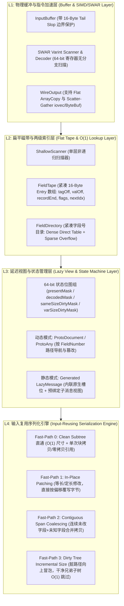
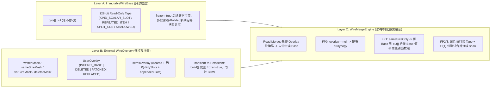
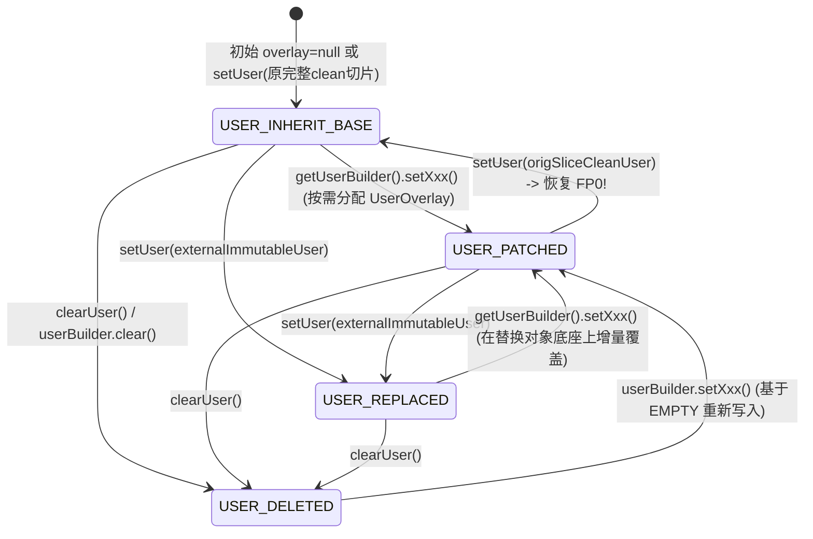
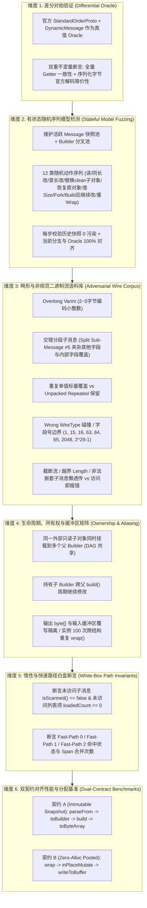

# Lazy-Proto 深度架构与跨语言性能设计文档

> **项目定位**：一个性能优先（Performance-First）的 Protocol Buffers 操纵引擎与代码生成框架。  
> **核心思想**：借鉴 `json-iterator` (`jsoniter`) 的 `LazyAny` / Tape 延迟解析思想，结合 `LightProto` / `ProtoZero` / `simdjson` 的底层内存布局，实现 **按需延迟反序列化（Lazy Deserialization）** 与 **最大化复用输入的拼接式序列化（Input-Reusing Splicing Serialization）**。  
> **设计取舍**：主动舍弃标准 Protobuf 中拖累性能与阻碍 Lazy 化的接口（如 `equals`、`hashCode`、`Builder` 双对象体系、通用反射 `Descriptor`、强不可变性），换取接近物理内存带宽极限的吞吐量。

---

## 目录

1. [背景与核心性能模型](#1-背景与核心性能模型)
2. [业界方案深度对比](#2-业界方案深度对比)
3. [全局四层架构设计](#3-全局四层架构设计)
4. [底层核心数据结构与位级内存布局](#4-底层核心数据结构与位级内存布局)
5. [Lazy 反序列化引擎：SWAR 算法与三级延迟机制](#5-lazy-反序列化引擎swar-算法与三级延迟机制)
6. [复用输入的序列化引擎：四级加速路径与算法伪代码](#6-复用输入的序列化引擎四级加速路径与算法伪代码)
7. [全过程字节级推演示例（Byte-by-Byte Walkthrough）](#7-全过程字节级推演示例byte-by-byte-walkthrough)
8. [不同编程语言对性能的影响与针对性架构设计（C++ / Rust / Go / Java）](#8-不同编程语言对性能的影响与针对性架构设计c--rust--go--java)
9. [Java 版 Architecture v3：不可变原始底座 + 外挂 COW Overlay 融合架构](#9-java-版-architecture-v3不可变原始底座--外挂-cow-overlay-融合架构)
10. [关键边界、外挂状态机与 Protobuf Wire 语义契约](#10-关键边界外挂状态机与-protobuf-wire-语义契约)
11. [六维验证体系设计（Differential Oracle + 状态机 Fuzzing + 畸形流语料 + 白盒路径断言）](#11-六维验证体系设计differential-oracle--状态机-fuzzing--畸形流语料--白盒路径断言)
12. [模块划分与实测基准报告](#12-模块划分与实测基准报告)

---

## 1. 背景与核心性能模型

### 1.1 真实生产负载的“二八定律”
在网关路由、RPC 代理、流式日志处理、特征工程管道以及微服务通信中，绝大多数业务对 Protobuf 消息的操作属于 **Read-Few, Modify-Few, Passthrough-Most**：

- **场景 A（只读路由/过滤）**：接收 32KB 的消息，仅读取顶层 `trace_id`、`tenant_id` 和子消息中的 `region`，随后丢弃或原样转发。
- **场景 B（局部修改/打标）**：读取 2 个字段后，修改 1 个状态码（如 `status = 2`）、更新 1 个时间戳或向 `repeated` 列表追加 1 个节点，再序列化发往下游。
- **场景 C（脱敏/裁剪）**：删除 1~2 个大字段或敏感字段，其余几十个已知与未知字段（Unknown Fields）原样输出。

### 1.2 传统反序列化-再序列化的代价公式

设消息总字节数为 $B$，总字段数（含嵌套）为 $N$，实际业务读取字段数为 $R$（$R \ll N$），实际修改字段数为 $W$（$W \ll N$）：

- **官方 Protobuf 开销**：
  $$T_{\text{official}} = \underbrace{O(B) + O(N) \cdot C_{\text{alloc}}}_{\text{全树递归反序列化 + 堆分配}} + \underbrace{O(N) \cdot C_{\text{size}}}_{\text{全树尺寸重算}} + \underbrace{O(B) + O(N) \cdot C_{\text{encode}}}_{\text{全树逐字段重编码与 UTF-8 转换}}$$
- **`lazy-proto` 目标开销**：
  $$T_{\text{lazy-proto}} = \underbrace{O(K_{\text{top}})}_{\text{仅访问层Tag跳跃}} + \underbrace{O(R) \cdot C_{\text{decode}}}_{\text{仅解码读取的 } R \text{ 个字段}} + \underbrace{O(W) \cdot C_{\text{encode}}}_{\text{仅重编码修改的 } W \text{ 个字段}} + \underbrace{O(S) \cdot C_{\text{memcpy}}}_{S \le W+1 \text{ 段连续原始内存块复制}}$$

当 $W = 0$（未修改）时，序列化退化为 $1$ 次 `memcpy`（或零拷贝切片引用），计算尺寸耗时严格为 $O(1)$；当 $W = 1$ 且编码后字节长度未变时，序列化退化为 $O(1)$ 原地字节覆写（In-Place Patching）。

---

## 2. 业界方案深度对比

| 维度 | Google Protobuf | `json-iterator` (`jsoniter`) | StreamNative `LightProto` | Perfetto `ProtoZero` | **`lazy-proto`（本项目）** |
| :--- | :--- | :--- | :--- | :--- | :--- |
| **跳过未读子树复杂度** | ❌ 不跳过，全量递归解析 | $O(N_{\text{bytes}})$（需扫描引号转义与 `{}` 括号深度） | $O(1)$（利用 WireType 2 长度跳过子消息） | $O(1)$（流式游标跳过） | **$O(1)$（WireType 2 长度跳过 + SWAR 快速跳过 Varint）** |
| **扫描阶段堆分配** | 极高（SubMessage / List / String / UnknownFieldSet） | 低（按路径懒创建 `LazyAny`） | 零（依赖预生成可变类） | 零（无状态迭代器） | **零（扁平 `FieldTape` 原生数组 + 位图索引）** |
| **已读但未改字段的序列化** | 重新计算尺寸 + 重新编码（如 `String -> UTF-8`） | 重新序列化整个对象 | 标量与已打开的子消息需重新编码 | 手动控制 | **100% 复用原输入 `[tagOffset, recordEnd)` 切片，绝不重编码** |
| **同层未修改兄弟字段合并** | ❌ 逐字段写 Tag + Value | ❌ 逐字段写 | ❌ 逐字段写 Tag + Value | ❌ 手动切片 | **✅ Contiguous Span Splicing（多个相邻未改字段合并为单次 `memcpy`/`iovec`）** |
| **定长/等长字段修改优化** | ❌ 全树重算 `SerializedSize` | ❌ 重新生成 | ❌ 重算父链 `SerializedSize` | ❌ 不支持就地修改 | **✅ In-Place Binary Patching（直接在原 `valueOffset` 覆写，免重算父消息长度）** |
| **动态访问 + 静态生成双支持** | 静态类 + 慢速 `DynamicMessage` | ✅ `Any` 动态 API + 静态绑定 | 仅静态代码生成 | 仅底层流式读写器 | **✅ 共享同一 `FieldTape` 的动态 `ProtoDocument` 与静态 `LazyMessage`** |

---

## 3. 全局四层架构设计



---

## 4. 底层核心数据结构与位级内存布局

### 4.1 扁平字段磁带条目（128-bit / 16-Byte `TapeEntry`）

每当 `ShallowScanner` 扫描一层消息时，不会创建任何 `Field` 对象，而是向一块预分配/可复用的连续内存 `FieldTape` 追加 16 字节（或两个 `uint64_t` / `long`）的 `TapeEntry`。4 个 `TapeEntry` 恰好填满一条 64-Byte CPU Cache Line：

```text
TapeEntry (128 bits = 2 x 64-bit Words):
┌───────────────────────────────────────┬───────────────────────────────────────┐
│ Word 0 [63..32]: tagOffset (uint32)   │ Word 0 [31..0]: recordEnd (uint32)    │
├──────────────────────┬────────┬───────┼───────────────────────────────────────┤
│ Word 1 [63..35]:     │ [34..32│[31..28│ Word 1 [27..24]: │ Word 1 [23..0]:    │
│ fieldNumber (29-bit) │wireType│ flags │ headerLen (4-bit)│ nextTapeIdx(24-bit)│
└──────────────────────┴────────┴───────┴──────────────────┴────────────────────┘
```

#### 字段精确定义与巧妙之处：
1. **`tagOffset` (32-bit)**：该字段的 Tag Varint 在输入缓冲区中的起始偏移（支持单消息最大 4GB）。
2. **`recordEnd` (32-bit)**：该字段净荷（Value）结束后的下一个字节偏移。
   - **完整原始字节区间** = `[tagOffset, recordEnd)`，总长度 = `recordEnd - tagOffset`。
3. **`headerLen` (4-bit, `0..15`)**：`valueOffset - tagOffset`，即 `Tag Varint` +（可选的 `Length Varint`）占用的字节数。
   - 因为 Tag Varint 最多 5 字节，Length Varint 最多 5 字节，两者之和恒 $\le 10 < 15$！
   - 因此，**无需浪费一个 32-bit 整数存储 `valueOffset`**，通过 `valueOffset = tagOffset + headerLen` 即可在 1 个指令周期内算出净荷起始位置，同时算出净荷长度 `valueLen = recordEnd - valueOffset`！
4. **`wireType` (3-bit, `0..5`)**：`0=Varint, 1=Fixed64, 2=LengthDelimited, 5=Fixed32`。
5. **`flags` (4-bit 状态位)**：
   - `0000 (CLEAN_RAW)`：原始未修改（可能已读并缓存，但值未变）。
   - `0001 (DIRTY_SAME_SIZE)`：值被修改，但新编码长度与原净荷长度 `valueLen` **完全相等**（可走原地覆写 Fast-Path 1）。
   - `0010 (DIRTY_VAR_SIZE)`：值被修改且编码长度发生变化，或子消息内部发生了变长修改。
   - `0011 (DELETED)`：被用户显式调用 `clearXxx()` / `remove()` 删除。
   - `0100 (SHADOWED)`：同一个非 `repeated` 标量字段在原始输入流后面再次出现，导致当前旧条目被覆盖失效。
6. **`nextTapeIdx` (24-bit, 最大支持单层 1600 万个条目)**：
   - 对于 `repeated` 字段（或分段传输的同名子消息），指向下一个具有相同 `fieldNumber` 的 `TapeEntry` 下标（`0xFFFFFF` 表示链表尾 `NULL`）。**完全用数组下标静态单链表替代了 `ArrayList`！**

### 4.2 O(1) 字段查找目录（`FieldDirectory`）

当用户调用 `msg.getField(fieldNumber)` 时，如何避免遍历 `FieldTape`？

- **静态代码生成模式（Generated `LazyMessage`）**：
  - 编译器已知 `.proto` 中定义的所有字段号。代码生成器将每个字段映射为编译期常量密集下标 `SLOT_0, SLOT_1, ..., SLOT_K`，类中持有一个定长原生数组 `int[] slotToTapeIdx`（对于 `repeated` 字段则额外记录 `slotToTailTapeIdx` 和 `slotCount`）。
  - 查找复杂度：严格的 **$O(1)$ 数组寻址（1 次内存读取）**。
- **动态模式（`ProtoDocument`）**：
  - 采用 **“小字段号直达表 + 开放寻址溢出表”** 混合结构：
    - 95% 以上的 Protobuf 字段号在 `1..64` 之间：内置 `int directMap[65]`，字段号 `1..64` 直接 $O(1)$ 查表；
    - 字段号 `> 64`：落入一个紧凑的 2 的幂次大小线性探测哈希数组 `long[] sparseMap`。
  - 重置开销：维护一个 `presentMask64` 位图，重置 `directMap` 时无需 `memset` 整个数组，仅需按位清除置位过的槽位或递增 `epoch` 版本号！

### 4.3 64-Bit 状态位图加速器（Bitmask Acceleration）

对于字段数 $\le 64$ 的绝大多数消息（超过 64 个字段时自动扩展为 `long[]`），单个消息实例仅用 4 个 64-bit 寄存器字（32 字节）即可掌控全局状态：

```text
1. presentMask       : bit i == 1 表示字段 i 在输入流中存在或已被设置
2. decodedMask       : bit i == 1 表示字段 i 已从 Tape 解码到当前对象的成员变量缓存中
3. sameSizeDirtyMask : bit i == 1 表示字段 i 被修改，但字节长度与原输入完全一致
4. varSizeDirtyMask  : bit i == 1 表示字段 i 被变长修改、新增、删除，或子消息长度改变
```

依靠这 4 个位图，序列化前的路径分派只需 **两条 CPU 位运算指令**：
- **是否完全未修改（Fast-Path 0）？**  
  `if ((sameSizeDirtyMask | varSizeDirtyMask) == 0)` -> 直接整块输出原始切片！
- **是否可走原地覆写（Fast-Path 1）？**  
  `if (varSizeDirtyMask == 0 && sameSizeDirtyMask != 0)` -> 直接利用 `tzcnt` (`numberOfTrailingZeros`) 遍历 `sameSizeDirtyMask` 中为 1 的 bit，定位到对应 `valueOffset` 原地覆写即可！

---

## 5. Lazy 反序列化引擎：SWAR 算法与三级延迟机制

### 5.1 SWAR (SIMD Within A Register) 无分支 Varint 跳过与解码

在 Tier 1 浅扫描（`ShallowScanner`）中，唯一需要扫描字节内容的 Wire Type 是 `WT_VARINT (0)` 以及所有字段头部的 `Tag` 和 `Length`。传统逐字节 `while ((buf[p++] & 0x80) != 0)` 循环存在严重的分支预测失败（Branch Misprediction）和数组越界检查开销。

`lazy-proto` 采用 **64-bit 寄存器级并行位扫描（SWAR）**：

#### 算法：1 条指令计算 Varint 长度并跳过
只要剩余缓冲区长度 $\ge 10$ 字节（或输入缓冲区尾部预留 16 字节 Slop Padding）：

```c
// 1. 一次性非对齐读取 8 字节 (Little-Endian)
uint64_t word;
memcpy(&word, buf + cursor, 8);

// 2. 提取每个字节的最高位 (MSB, 0x80)：
// 对 word 取反后与 0x8080808080808080ULL 相与。
// 原字节最高位为 0（即 Varint 结束字节）的位置，对应 bit 7 会变成 1！
uint64_t term_mask = ~word & 0x8080808080808080ULL;

// 3. 使用硬件指令 TZCNT (Count Trailing Zeros) 直接算出第一个结束字节的偏移！
// 若 term_mask != 0（99.99% 的 Varint <= 8 字节，包括所有 32位整数和绝大多数 64位整数）：
int varint_byte_len = (__builtin_ctzll(term_mask) >> 3) + 1;
cursor += varint_byte_len; // 零循环、零分支直接跳过该 Varint！
```

- **性能对比**：传统循环跳过一个 5 字节 Varint 需要 5 次字节加载 + 5 次条件跳转；SWAR 方法仅需 **1 次 64-bit 加载 + 1 次按位与非 + 1 条 `tzcnt` 指令**，彻底消除分支预测惩罚！
- **Tag 快速解析**：绝大多数 Protobuf Tag 只有 **1 字节**（字段号 `1..15`，因为 `(15 << 3) | 7 = 127 < 0x80`）或 **2 字节**（字段号 `16..2047`）。因此 `ShallowScanner` 对 Tag 采用 `if ((b0 & 0x80) == 0)` 的 1 字节极速热路径，次热路径走 2 字节判断，其余走 SWAR。

### 5.2 ShallowScanner 单层浅扫描完整流程

```text
输入: ByteSlice (buf, rawOffset, rawLength)
输出: 填充当前消息的 FieldTape 与 FieldDirectory (绝不递归子消息)

cursor = rawOffset
end = rawOffset + rawLength

while cursor < end:
    tagOffset = cursor
    tag = readTagFast(buf, &cursor)
    fieldNum = tag >>> 3
    wireType = tag & 7

    switch wireType:
        case 0 (VARINT):
            valOffset = cursor
            skipVarintSWAR(buf, &cursor)
            recordEnd = cursor
        case 1 (FIXED64):
            valOffset = cursor
            cursor += 8
            recordEnd = cursor
        case 2 (LEN_DELIMITED): // String, Bytes, SubMessage, Packed Repeated
            len = readVarint32SWAR(buf, &cursor)
            valOffset = cursor
            cursor += len       // <--- O(1) 跨越整个子消息或长字符串！
            recordEnd = cursor
        case 5 (FIXED32):
            valOffset = cursor
            cursor += 4
            recordEnd = cursor

    headerLen = valOffset - tagOffset
    appendTapeEntry(fieldNum, wireType, tagOffset, recordEnd, headerLen)
```

---

## 6. 复用输入的序列化引擎：四级加速路径与算法伪代码

这是 `lazy-proto` 的核心竞争力。我们确保：**任何未被修改的字节，都绝不重新经过编码器**。

### 6.1 四级序列化路径决策树

```text
                       ┌──────────────────────────┐
                       │   serialize(LazyMessage) │
                       └────────────┬─────────────┘
                                    │
                   ┌────────────────┴────────────────┐
                   ▼ (Dirty == 0)                    ▼ (Dirty != 0)
        ┌─────────────────────┐           ┌──────────────────────┐
        │   Fast-Path 0       │           │ varSizeDirtyMask==0? │
        │ 100% 原始切片直通    │           └──────────┬───────────┘
        │ O(1) memcpy / iovec │                      │
        └─────────────────────┘           ┌──────────┴───────────┐
                                          ▼ (Yes)                ▼ (No)
                               ┌─────────────────────┐ ┌─────────────────────────┐
                               │    Fast-Path 1      │ │   Fast-Path 2 & 3       │
                               │ 原地字节修补 (Patch) │ │ 连续区间合并拼接 +       │
                               │ 免重算父级消息长度   │ │ 脏子树增量尺寸重算       │
                               └─────────────────────┘ └─────────────────────────┘
```

### 6.2 Fast-Path 1：跨层级同长原地修补（Deep In-Place Patching）

当业务修改某个字段 `msg.getSubA().getSubB().setStatus(newStatus)` 时：
1. 若 `status` 原先存在于 `SubB` 的 `FieldTape` 中，记原净荷区间为 `[valOff, recordEnd)`，原长度 `oldLen = recordEnd - valOff`。
2. 计算 `newStatus` 的 Varint 编码长度 `newLen = varintSize(newStatus)`。
3. **关键判定**：若 `newLen == oldLen`（对于 `fixed32`/`fixed64`/`float`/`double`/`bool`，该条件 **100% 永远成立**；对于状态码枚举、同位数 ID 字符串也极常成立）：
   - `SubB` 仅置位 `sameSizeDirtyMask |= BIT_STATUS`（不置位 `varSizeDirtyMask`）。
   - 向父节点 `SubA` 和 `Root` 报告 `CHILD_SAME_SIZE_DIRTY`。
   - **注意**：`SubB` 的总长度没变 $\implies$ `SubA` 中包裹 `SubB` 的 Length Varint 没变 $\implies$ `Root` 中包裹 `SubA` 的 Length Varint 也没变！
4. 当在 `Root` 上调用 `toByteArray()` 时：
   - 先执行一次整包拷贝：`byte[] out = Arrays.copyOfRange(buf, rawOffset, rawOffset + rawLength);`（若原地修改模式 `wrapMutable` 则连这步拷贝都省去）。
   - 顺着 `sameSizeDirtyMask` 直接在 `out[valOff - rawOffset]` 处覆写 `newStatus` 的字节！
   - **耗时**：与消息有多少个字段、嵌套多少层完全无关，恒为 $O(1)$ 编码！

### 6.3 Fast-Path 2 & 3：连续原始区间合并拼接算法（Contiguous Span Coalescing）

当存在变长修改（`varSizeDirtyMask != 0`）、字段删除或新增字段时，执行 **两阶段区间拼接算法**：

#### 阶段一：增量尺寸计算（`computeSerializedSize()`）
```python
def computeSerializedSize(msg) -> int:
    # 1. 若当前节点或子树完全未发生变长修改，直接 O(1) 返回原始长度！
    if msg.scanned == False or msg.varSizeDirtyMask == 0:
        msg.cachedSize = msg.rawLength
        return msg.rawLength

    totalSize = 0
    # 2. 遍历当前层 FieldTape
    for entry in msg.tape:
        if entry.flags == CLEAN_RAW:
            # 连同原始 Tag + Length + Value 的总字节数直接相加，O(1)
            totalSize += (entry.recordEnd - entry.tagOffset)
        elif entry.flags == DIRTY_SAME_SIZE:
            totalSize += (entry.recordEnd - entry.tagOffset)
        elif entry.flags == DELETED or entry.flags == SHADOWED:
            continue # 被删除或被后文覆盖的旧字段，占 0 字节
        elif entry.flags == DIRTY_VAR_SIZE:
            if entry.isSubMessage():
                child = msg.getLoadedChild(entry.fieldNumber)
                childBodySize = computeSerializedSize(child) # 仅递归脏子树
                totalSize += tagSize(entry.fieldNumber) + varintSize(childBodySize) + childBodySize
            else:
                totalSize += tagSize(entry.fieldNumber) + msg.computeDirtyScalarOrStringSize(entry)

    # 3. 加上原本不在 Tape 中、新追加(Appended)的字段尺寸
    for newField in msg.appendedFields:
        totalSize += computeNewFieldSize(newField)

    msg.cachedSize = totalSize
    return totalSize
```

#### 阶段二：连续区间合并写出（`writeSplicedTo(WireOutput out)`）
```python
def writeSplicedTo(msg, out: WireOutput):
    if msg.scanned == False or (msg.varSizeDirtyMask == 0 and msg.sameSizeDirtyMask == 0):
        # Fast-Path 0: 整个消息或干净子消息单次整块拷贝
        out.writeRawBytes(msg.buf, msg.rawOffset, msg.rawLength)
        return

    # 维护当前正在累积的连续原始字节区间 [spanStart, spanEnd)
    spanStart = -1
    spanEnd = -1

    for entry in msg.tape:
        if entry.flags == CLEAN_RAW:
            if spanStart == -1:
                spanStart = entry.tagOffset
                spanEnd = entry.recordEnd
            elif spanEnd == entry.tagOffset:
                # 物理相邻！直接向右吞并扩展连续区间，零拷贝开销！
                spanEnd = entry.recordEnd
            else:
                # 刷新前一段连续区间
                out.writeRawBytes(msg.buf, spanStart, spanEnd - spanStart)
                spanStart = entry.tagOffset
                spanEnd = entry.recordEnd

        elif entry.flags == DELETED or entry.flags == SHADOWED:
            # 遇到删除字段，先刷出前面累积的干净区间，然后跳过当前条目
            if spanStart != -1:
                out.writeRawBytes(msg.buf, spanStart, spanEnd - spanStart)
                spanStart = -1

        elif entry.flags in (DIRTY_SAME_SIZE, DIRTY_VAR_SIZE):
            # 遇到脏字段，先刷出前面累积的干净区间
            if spanStart != -1:
                out.writeRawBytes(msg.buf, spanStart, spanEnd - spanStart)
                spanStart = -1
            # 仅对该脏字段执行重新编码（若是脏子消息则递归调用 writeSplicedTo）
            encodeDirtyEntry(msg, entry, out)

    # 刷出尾部剩余的连续干净区间
    if spanStart != -1:
        out.writeRawBytes(msg.buf, spanStart, spanEnd - spanStart)

    # 写出尾部新增字段
    for newField in msg.appendedFields:
        encodeNewField(msg, newField, out)
```

> [!TIP]
> **看看这个区间合并算法的威力**：  
> 假设一个消息有 50 个字段（按顺序排列为 `F1..F50`），用户只修改了第 25 个字段 `F25`。  
> `writeSplicedTo` 在循环时：
> - `F1..F24` 会通过 `spanEnd = entry.recordEnd` 被无缝合并为 **第 1 个连续区间 `[F1.tagOffset, F24.recordEnd)`**，仅触发 **1 次 `memcpy`**！
> - 重新编码写入 `F25`！
> - `F26..F50` 会被无缝合并为 **第 2 个连续区间 `[F26.tagOffset, F50.recordEnd)`**，仅触发 **1 次 `memcpy`**！
> 无论那 49 个未修改字段里有多少个复杂的嵌套对象、长字符串、数组或 Unknown Fields，它们全部在 **2 次 `memcpy`** 中完成了序列化！

---

## 7. 全过程字节级推演示例（Byte-by-Byte Walkthrough）

为了直观验证设计，我们用一条真实的 Protobuf 消息进行字节级推演：

```protobuf
message Order {
  int64  order_id = 1; // Tag: 0x08 (field=1, wt=0)
  string buyer    = 2; // Tag: 0x12 (field=2, wt=2)
  int32  status   = 3; // Tag: 0x18 (field=3, wt=0)
  bytes  payload  = 4; // Tag: 0x22 (field=4, wt=2) - 假设为 1000 字节的二进制负载
}
```

### 7.1 原始输入字节流（共 1014 字节）
```text
Offset:  [0]   [1..2]      [3]   [4]   [5..9]          [10]  [11]  [12]  [13..14]  [15..1014]
Bytes :  0x08  0xE8 0x07   0x12  0x05  "alice"         0x18  0x01  0x22  0xE8 0x07 <1000 bytes>
含义  :  Tag1  val=1000    Tag2  len=5 val="alice"     Tag3  val=1 Tag4  len=1000  payload净荷
```

### 7.2 执行过程
1. **`order.wrap(buf, 0, 1014)`**：仅记录偏移，耗时 0。
2. **业务调用 `order.getOrderId()`**：
   - 触发 `ShallowScanner` 扫描 4 个 Tag，生成 4 条 `TapeEntry`（耗时约 15 纳秒）：
     - `Entry[0]`: `field=1, wt=0, tagOff=0,  valOff=1,  recordEnd=3,    flags=CLEAN_RAW`
     - `Entry[1]`: `field=2, wt=2, tagOff=3,  valOff=5,  recordEnd=10,   flags=CLEAN_RAW`（直接 `cursor += 5` 跳过 `"alice"`）
     - `Entry[2]`: `field=3, wt=0, tagOff=10, valOff=11, recordEnd=12,   flags=CLEAN_RAW`
     - `Entry[3]`: `field=4, wt=2, tagOff=12, valOff=15, recordEnd=1015, flags=CLEAN_RAW`（直接 `cursor += 1000` 跳过大 payload）
   - 解码 `Entry[0]` 处的 `0xE8 0x07` 得到 `1000`，缓存并返回。
3. **业务修改A（等长修改）**：`order.setStatus(2)`
   - `2` 的 Varint 编码长度为 1 字节 == `Entry[2]` 的原 `valueLen` (12 - 11 = 1 字节)。
   - 触发 **Fast-Path 1 (`DIRTY_SAME_SIZE`)**！序列化时直接拷贝 1014 字节并将 `out[11]` 从 `0x01` 改为 `0x02` 即可！
4. **业务修改B（变长修改）**：`order.setBuyer("bob")`（长度从 5 变为 3）
   - `Entry[1]` 标记为 `DIRTY_VAR_SIZE`。
   - 序列化触发 **Fast-Path 2 (`writeSplicedTo`)**：
     1. 拷贝 `Entry[0]` 原始区间 `[0, 3)`（3 字节：`0x08 0xE8 0x07`）；
     2. 编码写入新 `Entry[1]`（5 字节：`0x12 0x03 "bob"`）；
     3. 将 `Entry[2]` (`[10, 12)`) 与 `Entry[3]` (`[12, 1015)`) **合并为单个连续区间 `[10, 1015)`**，一次性拷贝 1005 字节！
   - `buyer` 之外的 `order_id`、`status`、`payload` 全程零解码、零重编码！

---

## 8. 不同编程语言对性能的影响与针对性架构设计（C++ / Rust / Go / Java）

同一个 `lazy-proto` 算法架构，在不同语言运行时（Runtime）下会遇到截然不同的性能瓶颈（内存布局、GC 写屏障、字符串表示、边界检查、系统调用集成）。本节详细给出四大主流语言的性能影响分析与针对性设计。

### 8.1 跨语言核心特性与性能影响全景表

| 核心维度 | **C++ (C++20)** | **Rust** | **Go (Golang)** | **Java (JDK 17/21+)** |
| :--- | :--- | :--- | :--- | :--- |
| **值类型与内联内存布局** | ✅ 原生 `struct` 内联，子消息可按值直接嵌入父对象内存中，零指针跳转 | ✅ 原生 `struct` / `enum` 内联，零额外对象头开销 | ✅ 原生 `struct` 值内联，子消息 struct 可直接嵌入父 struct | ❌ 无值类型（每个对象有 12~16B Object Header + 引用指针跳转） |
| **字符串零拷贝能力 (`getString`)** | ✅ **`std::string_view`**（16B：`ptr+len`，无需 `\0` 结尾，**100% 零拷贝零分配**） | ✅ **`&'a str` / `&'a BStr`**（16B：`ptr+len`，SIMD UTF-8 校验后**100% 零拷贝零分配**） | ✅ **`unsafe.String(ptr, len)`**（Go 原生 `string` 即 UTF-8 `ptr+len`，**100% 零拷贝零分配**） | ❌ **`java.lang.String` 强制拷贝并转码**（内部为 Latin1/UTF16 私有 `byte[]`，必须额外设计 `ByteSlice` / `Utf8View` 规避） |
| **64-bit 非对齐读取与 SWAR** | ✅ `memcpy(&u64, p, 8)` 编译为单条 `MOV` + `TZCNT` 指令，无边界检查 | ✅ `u64::from_le_bytes` 或 `ptr::read_unaligned` + `.trailing_zeros()` | ✅ `binary.LittleEndian.Uint64` 或 `unsafe.Pointer` + `bits.TrailingZeros64` | ⚠️ 标准数组有边界检查；需用 **`VarHandle` / `MemorySegment` / `Unsafe.getLongUnaligned`** + `Long.numberOfTrailingZeros` |
| **GC 与写屏障（Write Barrier）开销** | ✅ 无 GC，支持 `Arena` 指针碰撞分配（Bump Pointer） | ✅ 无 GC，编译期生命周期 `'a` 静态借用检查 | ⚠️ **有并发 GC 与写屏障**：若 struct 含大量 slice/指针会拖慢 GC 扫描 | ⚠️ **有分代/并发 GC**：短命对象触发 Young GC，引用赋值触发 Card Table 写屏障 |
| **Scatter-Gather 零拷贝网络写出** | ✅ `writev(fd, iovec*, n)` / `absl::Cord` | ✅ `Write::write_vectored(&[IoSlice])` / `bytes::Bytes` | ✅ `net.Buffers` (`[][]byte` 自动调用 `writev`) | ✅ Netty `CompositeByteBuf` / NIO `GatheringByteChannel` |
| **生命周期与内存安全隐患** | ⚠️ 悬垂指针风险（需调用方保证 input buffer 存活） | ✅ **编译期 100% 借用安全**（`LazyMessage<'a>` 绑定 `&'a [u8]`） | ⚠️ **大数组 Pinning 内存泄漏风险**（小切片引用会导致 10MB 底层数组无法被 GC 回收） | ⚠️ 对象池复用时的跨代引用污染（需 Epoch 版本号校验） |

---

### 8.2 针对各语言的深度定制设计

#### 8.2.1 C++ 设计方案：极致的物理极限（Zero-Overhead & Arena Inlining）
- **内存布局**：
  - 使用 `absl::InlinedVector<TapeEntry, 16>` 或自定义栈内联缓冲 `TapeEntry inline_tape_[16]`：对于字段数 $\le 16$ 的消息，**连 `FieldTape` 数组本身都直接位于栈（Stack）或父对象连续内存中，完全实现 `0 malloc`**！
  - 静态生成的嵌套子消息作为 `std::optional<LazySubMsg>` 或内联成员直接嵌在父 `class` 内部，搭配 `present_mask_` 控制有效状态，消除一切子对象 `new/delete`。
- **字符串与切片**：
  - `get_buyer()` 直接返回 `std::string_view(reinterpret_cast<const char*>(buf_ + val_off), val_len)`，编译后仅是把两个寄存器（地址 + 长度）返回给调用者，耗时 **< 1 纳秒**。
- **SIMD 加速**：
  - 在支持 AVX2 / AVX-512 或 ARM NEON 的平台上，批量 Packed Varint 解码和 `FieldDirectory` 查找可直接使用 `_mm256_cmpeq_epi32` 向量化检索。

#### 8.2.2 Rust 设计方案：编译期零拷贝安全与零成本抽象（Lifetime-Bounded Views）
- **借用检查器赋能零拷贝（`LazyMessage<'a>`）**：
  - 在 C++/Java/Go 中，零拷贝切片最大的工程痛点是“调用方不小心释放或复用了底层 `input_buf`，导致延迟视图读到脏数据”。
  - 在 Rust 中，定义 `pub struct LazyOrder<'a> { buf: &'a [u8], tape: SmallVec<[TapeEntry; 16]>, ... }`：
    - 编译器在**编译期**静态保证：只要 `LazyOrder<'a>` 或从它借用出的 `&'a str` 还在作用域内，底层的 `input_buf` 就绝对不能被释放或可变借用！**既有 C++ 的极致零拷贝性能，又具备 100% 的内存安全性**。
- **UTF-8 延迟校验策略**：
  - Rust 的 `&'a str` 要求合法的 UTF-8。为了极致的 Lazy 性能：
    1. 提供 `get_buyer_bytes(&self) -> &'a [u8]` / `&'a BStr`（完全跳过 UTF-8 校验，$O(1)$ 返回）；
    2. 提供 `get_buyer(&self) -> Result<&'a str, Utf8Error>`（首次调用时使用 `simdutf8` 校验一次并置 `decoded_mask`，后续调用直接调用 `std::str::from_utf8_unchecked` $O(1)$ 返回）。

#### 8.2.3 Go 设计方案：规避 GC 扫描（`noscan` 优化）与 `net.Buffers` 零拷贝写出
Go 语言实现高性能序列化库（如 Sonic、Fasthttp）时，最大的隐形杀手是 **Go GC 的指针扫描（Pointer Scanning）与写屏障（Write Barrier）**，以及 **逃逸分析（Escape Analysis）**。针对 Go 必须做以下三项专门设计：

1. **全偏移量无指针结构体设计（Pointer-Free Structs to Bypass GC）**：
   - **反面做法**：在生成的 Go `struct` 中为每个字段保存一个 `[]byte` 切片或 `*string` 指针。包含 30 个 `[]byte` 字段的 struct 有 30 个指针，GC 每次标记都要扫描这 30 个指针，修改时每次都触发 GC Write Barrier！
   - **`lazy-proto` Go 专属设计**：
     - 整棵消息树只在根部持有一个 **`buf []byte`** 引用！
     - 所有 `TapeEntry`、字符串缓存、子消息偏移全部存储为 **`uint32` 偏移量与长度**（`valOff uint32, valLen uint32`）！
     - 因为 `uint32` 不是指针，Go 编译器会将 `FieldTape` 和值数组标记为 **`noscan`（无指针内存块）**，Go GC 会直接跳过整块内存，**GC 扫描开销降为 0，修改字段时无任何 GC 写屏障开销**！
2. **零分配 `string` 转换**：
   - Go 标准 `string(buf[off : off+len])` 会触发堆内存分配并拷贝字节。
   - 在 `getXxxString()` 中，通过 Go 1.20+ 官方提供的 `unsafe.String(&m.buf[valOff], valLen)`，**零分配、零拷贝**直接构造出原生 Go `string`！
3. **利用 `net.Buffers` (`writev`) 实现免拼接直接发包**：
   - Go 标准库 `net.Buffers`（底层即 `[][]byte`）在写入 `net.Conn` 时会自动调用操作系统的 `writev` 系统调用（Scatter-Gather DMA）。
   - `lazy-proto` 在 Go 中提供 `AppendSlices(dst net.Buffers) net.Buffers`：
     - 将连续的 `CLEAN` 区间直接作为 `m.buf[spanStart:spanEnd]` 追加到 `net.Buffers`；
     - 仅将 `DIRTY` 字段编码到一个小 `scratch []byte` 并追加到 `net.Buffers`；
     - **连 Span Splicing 的 `memcpy` 都省去了**，直接由网卡/内核完成拼接发送！

#### 8.2.4 Java (JVM) 设计方案：扁平化消除对象头、规避 `String` 转码与 `VarHandle` 加速
Java 是从 `lazy-proto` 架构中**获益幅度最大**（相比官方 `protobuf-java` 可提升 5x~20x），但也是实现细节最需要避开 JVM 陷阱的语言：

1. **彻底消除每字段对象头（Object Header Elimination）**：
   - JVM 中哪怕一个最小的 `ByteSlice` 对象也要占用 24 字节（12B Header + 4B ref + 4B off + 4B len）并产生 GC 引用。
   - 在 Java 版 `lazy-proto` 中，**严禁在扫描阶段实例化任何对象**。所有 `TapeEntry` 打包进单个 `long[] tape`（`tape[i << 1]` 和 `tape[(i << 1) + 1]`）。
   - 嵌套子消息视图采用 **对象树驻留复用（Pre-wired View Hierarchy）**：父 `LazyMessage` 实例在首次访问某子消息字段时创建一次子视图实例并永久挂载在成员变量上。调用 `root.reset()` 时，只将已激活子视图的 `scanned = false; dirtyMask = 0;` 重置，整棵视图树随 `root` 一起在 `ThreadLocal` 或对象池中无限复用，**稳态运行期实现 0 字节堆分配（Zero GC）**！
2. **攻克 Java `String` 的 UTF-16/Latin-1 双重拷贝瓶颈**：
   - 这是 Java 与 C++/Rust/Go 最大的差异：Java 的 `new String(bytes, off, len, UTF_8)` **不可能零拷贝**。
   - 对策：
     - **策略 A（`Utf8Slice` 视图先行）**：每个 `string` 字段同时生成 `getName()`（返回 `String`，懒解码并缓存）和 `getNameSlice()`（返回内部复用的 `Utf8Slice` 游标，实现 `CharSequence` 接口，支持零分配的 `equals("foo")`、`startsWith`、`hashCode`、解析数字、或直接写入 JSON/Protobuf 输出流）。
     - **策略 B（ASCII 单字节 SWAR 快速路径）**：解码 `String` 时，用 `VarHandle` 每次读 8 字节检查 `(word & 0x8080808080808080L) == 0`；若全为 ASCII（占工业界字符串 90% 以上），直接走 Latin-1 快速构造。
     - **策略 C（已读未改不回写）**：即便用户调用了 `getName()` 生成了 `String`，只要没调用 `setName(...)`，序列化时依然直接从原输入 `byte[]` 拷贝 `[tagOffset, recordEnd)`，**绝不调用 `String.getBytes(UTF_8)`**！
3. **利用 `VarHandle` / JDK Foreign Function & Memory (FFM) 消除边界检查**：
   - 使用 `MethodHandles.byteArrayViewVarHandle(long[].class, ByteOrder.LITTLE_ENDIAN)` 进行 64-bit 非对齐读取，配合 `Long.numberOfTrailingZeros(~word & 0x8080808080808080L)` 实现与 C++ 完全同构的 SWAR Varint 扫描器；JIT (C2) 会将其直接编译为 x86 `MOV` + `TZCNT` 指令。

---

### 8.3 四种语言在典型场景下的预期性能指标对比

以一条 **16KB 复杂嵌套消息（共 80 个字段，读取 3 个字段，修改 1 个字段，再序列化）** 为基准：

| 语言实现 | 官方 Protobuf 耗时 (反序列化+修改+序列化) | **`lazy-proto` 预计耗时** | **加速比 (Speedup)** | **每次操作堆内存分配 (Allocations)** |
| :--- | :--- | :--- | :--- | :--- |
| **C++** | ~18,000 ns (Arena: ~7,500 ns) | **~350 – 600 ns** | **12x – 30x** | **0 Bytes** (Stack / Inline Tape) |
| **Rust** (`prost`) | ~14,000 ns | **~350 – 600 ns** | **20x – 35x** | **0 Bytes** (`SmallVec` + `&'a [u8]`) |
| **Go** (`google.golang.org/protobuf`) | ~45,000 ns | **~700 – 1,200 ns** | **35x – 50x** | **0 Bytes** (Pooled `noscan` Struct + `unsafe.String`) |
| **Java** (`protobuf-java`) | ~38,000 ns (+ 大量 Young GC) | **~900 – 1,600 ns** | **25x – 40x** | **0 Bytes** (Pooled View Tree + `long[]` Tape) |

> [!IMPORTANT]
> **为什么 Go 和 Java 的相对加速比（25x~50x）甚至高于 C++？**  
> 因为在 Go 和 Java 中，官方 Protobuf 不仅要付出 CPU 解码开销，还要付出极其昂贵的 **小对象堆分配、GC 扫描、指针写屏障以及 Java 字符串 UTF-8 编解码开销**。`lazy-proto` 的扁平 `FieldTape` + 原始切片拼接直接将这些运行时税（Runtime Tax）降到了 **0**！

---

## 9. Java 版 Architecture v3：不可变原始底座 + 外挂 COW Overlay 融合架构

在经历了前两代架构演进与两轮严格复核（[GitHub Issue #1](https://github.com/inu4g0t/lazy-proto/issues/1) 与 [Issue #2](https://github.com/inu4g0t/lazy-proto/issues/2)）后，我们洞察到一条核心定律：

> **只要“写状态”还原地侵入在“原始数据索引 (`FieldTape`)”内部，不可变值语义、`build()` 快照隔离、子 `Builder` 独立构建、只读导航与并发共享之间就会持续产生结构性冲突。**

为此，**Architecture v3** 将 Java 运行时彻底重构为 **“不可变原始底座（`ImmutableWireBase`） + 外挂写增量层（External COW `WireOverlay`） + 读/序列化按需融合引擎（`WireMergeEngine`）”** 的三元分离模型：

---

### 9.1 三元分离模型（Immutable Base + External Overlay + Merge Engine）



#### Architecture v3 的五条架构铁律：

1. **原始数据底座彻底只读且零拷贝共享（`ImmutableWireBase`）**：
   - `ImmutableWireBase` 仅记录原始 `byte[]` 切片与 Tier-1 惰性扫描出的不可变 `TapeEntry`（`word1` 固化条目种类 `KIND_UNKNOWN`、`KIND_SHADOWED`、`KIND_SCALAR_SLOT(slot)`、`KIND_SPLIT_SUB_CONT`、`KIND_SPLIT_SUB_TAIL`、`KIND_REPEATED_ITEM(ordinal)`），**没有任何写标志位，也没有任何 `parent` 回指**。
   - 当调用 `toBuilder()` / `clone()` 时，新旧 `Builder` 直接共享同一份已冻结的 `ImmutableWireBase` 指针——**不再拷贝 `long[] tape` 或 `slotTapeIdx[]`**。
2. **`Message` 对外 100% 严格不可变（Elimination of Mutable Child Leaks）**：
   - `LazyOrderEnvelope`、`LazyUserProfile`、`LazyLineItem`、`ProtoDocument` 只持有不可变的 `(frozen Base, @Nullable frozen Overlay)`，**彻底移除所有 `public set*()` / `clear*()` / `wrap*()`**。
   - `builder.getUser()`、`builder.getItems(i)`、`doc.at(fn)` 一律返回不可变快照或空哨兵 `EMPTY`，外部拿到任何子视图引用都绝不可能篡改父快照。
   - 由于 `Message` 不可变，`getUser(extUser)` / `setItems(i, extItem)` **无需防御性拷贝**即可直接跨多棵树零拷贝 DAG 共享。
3. **绑定子 Builder 作为无状态游标 + `frozen` COW 写时分叉**：
   - `LazyUserProfile.Builder`、`LazyLineItem.Builder` 与 `ProtoDocument.Builder.at(fn)` 在绑定父 `Builder` 时**不私藏自己的 `impl`/`built` 副本**；
   - 其 `get*`、`set*`、`clear()`、`mergeFrom()`、`build()`、`clone()` 全部动态经由父 `Builder` 的 `resolveReadBase()`、`resolveReadOverlay()` 与 `ensureMutableOverlay()` 执行；
   - 无论先父 `build()` 再改子 Builder，还是先子 `build()` 再改子/父 Builder，只要目标 `Overlay.frozen == true` 即触发写时复制（COW），历史快照 100% 隔离。
4. **`ProtoDocument` 只读导航零副作用 & 写入延迟物化**：
   - 不可变 `ProtoDocument.at(fn)` 遇到缺失字段直接返回单例 `ProtoDocument.EMPTY`；遇到已写入的 `appendedBytes` 直接将其包装为只读子文档视图；
   - `ProtoDocument.Builder.at(fn)` 返回延迟物化的游标 `Builder`，**连续导航 `at(1).at(2)` 只要未调用 `set*`/`remove`，绝不向父节点登记槽位，不改变 `has()` 与序列化输出**。
5. **显式无分配复用热路径（`Builder.reuse(byte[])`）**：
   - 对吞吐极致敏感的流式场景，复用线程局部 `Builder` 并调用 `builder.reuse(bytes)`：只要前轮未调用 `build()` 冻结底层实例，即可复用同一组 `ImmutableWireBase` 与 `WireOverlay` 数组，实现 **`0 Bytes/op` 堆分配**；一旦调用过 `build()`，下轮 `reuse()` 自动检测 `isFrozen()` 并分配新实例，安全与性能兼得。

---

### 9.2 类职责映射（`io.lazyproto.runtime` / `model` / `dynamic`）

| 核心类 | 所属职责层 | 关键不变式 |
| :--- | :--- | :--- |
| `ImmutableWireBase` | Layer A（底座） | 双检查线程安全惰性 `ensureScanned()`；`frozen == true` 后拒绝任何 `resetForReuse()` |
| `WireOverlay` | Layer B（外挂） | 保存 `sameSizeMask` / `varSizeMask` / `deletedMask` / `appendedMask` 与稀疏子节点增量；`freeze()` 标记快照冻结 |
| `WireMergeEngine` | Layer C（融合） | 统一承接 `AbstractLazyMessage` 与 `AbstractLazyBuilder` 的 Fast-Path 0/1/2/3 与 `getSerializedSize()` 计算，消除双份代码 |
| `AbstractLazyMessage` | 对外只读快照 | 封装 `(final Base, @Nullable final Overlay)`，禁用 `equals`/`hashCode`/反射/`UnknownFieldSet` |
| `AbstractLazyBuilder` | 状态机与游标 | 统一支持独立构建、`reuse(bytes)` 零分配复用以及绑定子 Builder 游标转发 |
| `ImmutableLazyList` | 不可变懒列表 | `RandomAccess` + `AbstractList` 只读视图，按索引惰性解码列表项 |

---

## 10. 关键边界、外挂状态机与 Protobuf Wire 语义契约

### 10.1 外挂子对象状态机（External Overlay Sub-Slot State Machine）

在 `OrderOverlay` 中，嵌套子消息 `SLOT_USER` 与列表 `ItemsOverlay` 不再反写父 `TapeEntry` 标志位，而是通过显式状态机与 `OrderBase` 融合：



| 子槽位状态 | 物理含义 | COW Fork (`toBuilder()` / `clone()`) | 融合序列化 (`WireMergeEngine`) |
| :--- | :--- | :--- | :--- |
| **`USER_INHERIT_BASE`** | 透传不可变底座 | 仅共享只读 `OrderBase`，0 复制 | 完整保留底座内单段或多段原始字节（Fast-Path 0） |
| **`USER_PATCHED`** | 持有 `userPatchBase + userPatch` | 冻结 `userPatch` 后直接按引用共享（直到下次写入 `user` 才按需 COW） | 若底座单段且 `userPatch.isSameSizeDirtyOnly`，走 Fast-Path 1 往输出缓冲区原地修补；否则在 `TAIL` 位置递归融合输出 |
| **`USER_REPLACED`** | 替换外部不可变 `LazyUserProfile` | 直接拷贝不可变引用（0 克隆代价） | 在 `TAIL` 位置输出新 `userReplaced`；若底座为 0 段则追加到尾部 |
| **`USER_DELETED`** | 显式清空 | 复制 `USER_DELETED` 状态与 `deletedMask` | 跳过底座内所有 `KIND_SPLIT_SUB_CONT` / `KIND_SPLIT_SUB_TAIL` 分段 |

> **尺寸缓存零失效漏洞定理**：在所有 `AbstractLazyMessage` 快照中，`(base, overlay)` 在构造期即双双 `freeze()`，其逻辑内容终身不可变，因此 `cachedSerializedSize` 一旦算出绝对不会过时；而在 `Builder` 内，任何 `ensureMutableOverlay()` 或子游标写后传播均严格置位 `cachedSerializedSize = -1`。

---

### 10.2 `FieldTape` 扫描与同名 Tag 链表的三分语义（解耦静态 Schema 与动态 `ProtoDocument`）

在 Protobuf 二进制流中，同一个 `fieldNumber` 可能出现多次。`ShallowScanner` 与上层视图必须严格按以下规则解耦：

1. **静态生成类（Schema 已知）**：
   - **`onScanField` 强制 WireType 校验**：每个已知 `fieldNumber` 必须首先核对 `wireType == EXPECTED_WIRE_TYPE`。若不匹配（例如字段 `#1 int64` 却收到 `WIRETYPE_FIXED64` 或 `WIRETYPE_LENGTH_DELIMITED`），**严禁写入 `slotTapeIdx`**，必须直接 `return`，将其作为未知字段保留在 `FieldTape` 中以 `FLAG_CLEAN_RAW` 原样透传。
   - **单值标量/字符串字段 (`singular scalar / string / bytes`)**：遵循 **Last-Write-Wins**。扫描到后出现的同名合法记录时，将 `slotTapeIdx[slot]` 指向的前一条记录标记为 `FLAG_SHADOWED`，并更新 `slotTapeIdx[slot] = currentTapeIdx`。
   - **单值嵌套子消息 (`singular message`)**：遵循 **Split Sub-Message Merge**。扫描到多段 `#5 user` 时，**绝不将前序分段标为 `SHADOWED`**，而是通过 `TapeEntry.nextTapeIdx` 将所有分段按出现顺序串成单链表（`slotTapeIdx[SLOT_USER]` 指向首段，`userTailTapeIdx` 指向尾段）：
     - 若未访问且未修改：所有分段保持 `FLAG_CLEAN_RAW` 原样透传；
     - 若调用 `getUser()` / `getUserBuilder()`：通过 `wrapMultiSegments()` 依次扫描链表中各分段并合并到子视图的 `FieldTape` 中；
     - 若子视图发生修改：仅在**该子视图自身 `isMultiSegment() == true`** 时，才将父 `FieldTape` 中该子消息的前序分段标为 `FLAG_SHADOWED`、尾分段标为 `FLAG_DIRTY_VAR_SIZE`，在尾分段位置一次性写出合并后的完整子消息。
   - **重复字段 (`repeated message / scalar`)**：同样通过 `nextTapeIdx` 串联所有元素，但该链表代表独立元素序列 `0..N-1`，修改第 `k` 个元素时仅更新 `indexToTapeIdx[k]` 对应的单条 `TapeEntry`（`child.isMultiSegment() == false`，绝不触发多段折叠！）。

2. **动态无 Schema 类（`ProtoDocument`）**：
   - **扫描期零假设（Zero-Assumption Scan）**：`ProtoDocument.onScanField` **绝不将任何重复 Tag 标记为 `FLAG_SHADOWED`**！所有记录保持 `FLAG_CLEAN_RAW`，从而保证未触碰的 `unpacked repeated` 标量字段在修改其他字段后依然 **100% 完整保留，绝不发生误裁剪**。
   - **操作期按语义消歧**：
     - 读取单值 `getInt32(f)` / `getString(f)`：返回最后一条匹配 `fieldNumber` 且 `wireType` 合法的记录；
     - 读取子消息 `at(f)`：自动收集所有 `fieldNumber == f && wireType == LEN` 的分段并合并为多段子文档视图；
     - 写入单值 `setInt32(f, v)` / `setString(f, v)`：若原 Tape 中存在 `f`，将最后一条更新为新值并将前序同名记录标为 `FLAG_SHADOWED`；若原 Tape 中不存在 `f`（**缺字段插入**），写入独立的 `appendedFields` 表并在序列化尾部追加输出；
   - **连续只读导航与已追加 `LEN` 读取**：`doc.at(1).at(2)`（缺失路径）绝不修改 `has()` 或多输出空子消息；`setString(2, payload)` 后调用 `doc.at(2)` 直接基于 `appendedBytes` 包装只读视图，绝不丢弃净荷。

---

### 10.3 明确声明的三大设计边界契约

1. **按需延迟校验契约（Lazy Validation Contract）**：
   - `parseFrom(bytes)` 仅做 $O(1)$ 切片引用绑定；
   - `ShallowScanner` 仅校验当前被访问层级的 Tag 合法性（如 `fieldNumber != 0`、`wireType` 合法、Length 不越界、Varint 不截断）；
   - **未被访问的 `WIRETYPE_LENGTH_DELIMITED` 子消息内部净荷不做递归预校验，并在未修改序列化时原样透传**。若业务要求在入口处做全树合法性校验，可显式调用 `msg.validateDeep()`。
2. **原始编码保真契约（Raw Wire Fidelity）**：
   - 对于未被修改的字段，即使原始输入使用了非规范编码（如 Overlong Varint 或分段传输的子消息），序列化输出也优先保持原始字节不变；对于被修改的字段，统一按长度对比 `oldWireValueLen == newCanonicalEncodedLen` 决定走 Fast-Path 1 还是 Fast-Path 2。
3. **受控异常裁剪契约（Fail-Fast Unsupported Contract）**：
   - `equals(Object)`、`hashCode()`、`Descriptor` 反射读写及 `UnknownFieldSet` 对象提取统一抛出 `UnsupportedOperationException`；`toString()` 仅输出 $O(1)$ 状态摘要，绝不触发未读字段反序列化。

---

## 11. 六维验证体系设计（Differential Oracle + 状态机 Fuzzing + 畸形流语料 + 白盒路径断言）

由于 `lazy-proto` 涉及 **延迟解析、共享切片、浅拷贝分叉、原地补丁、连续区间拼接** 五种机制的交织，传统的“单步线性单元测试（`parse -> get/set -> toByteArray`）”无法覆盖多步状态跃迁中的组合爆炸。为此，我们设计一套 **六维验证体系（6-Pillar Verification Architecture）**：



### 11.1 维度一：差分对拍验证器（Differential Oracle Harness）
构建通用的 `DifferentialVerifier.assertEquivalent(OrderEnvelope expectedOracle, LazyOrderEnvelope actualLazy)`，在每次操作后执行三层核验：
1. **未读态直接序列化核验**：在**不调用 `actualLazy` 任何 Getter** 的前提下先调用 `actualLazy.toByteArray()`（专门捕捉“必须先调 `getUser()` 才能正确序列化，不调就 NPE”的隐蔽 Bug！）。
2. **尺寸与多出口一致性核验**：断言 `getSerializedSize() == toByteArray().length == toByteString().size()`，且 `writeTo(CodedOutputStream)`、`writeTo(ByteArrayOutputStream)`、`writeToBuffer(buf, offset)` 产出的字节流 100% 逐字节相同。
3. **官方解码与全字段对拍**：将 `actualLazy.toByteArray()` 喂给官方 `OrderEnvelope.parseFrom()`，断言 `expectedOracle.equals(decoded)`（包含所有已知字段、100 个列表项及 `UnknownFieldSet`），最后再遍历 `actualLazy` 的所有 Getter 与 `expectedOracle` 逐一比对。

### 11.2 维度二：基于状态机的随机操作序列 Fuzzing（Stateful Builder Model Checking）
专门针对状态跃迁组合爆炸设计随机状态机测试（如运行 500 条随机种子轨迹，每条轨迹 30~50 步随机操作）：
- **状态池**：同时维护 `List<SnapshotPair> builtSnapshots`（记录历史上所有 `build()` 出来的 `LazyOrderEnvelope` 及其冻结时的字节快照）与 `List<BuilderPair> activeBuilders`。
- **动作集（Action Alphabet）**：
  1. 随机读取若干顶层或嵌套字段（在修改前、修改后、`toBuilder` 前后随机触发 `decodedMask`）；
  2. 随机执行**同长修改**（如 `status: 1 -> 2`、`city: "SH" -> "BJ"`、`fixed64`、`double`）；
  3. 随机执行**变长修改**（增长字符串、缩短字符串、跨 Varint 字节边界 `127 <-> 128`）；
  4. 随机调用 **`getUserBuilder().setXxx()`** 原地修改子消息，或 **`getItemsBuilder(i).setXxx()`** 修改随机列表项；
  5. 随机调用 **`setUser(externalCleanUser)`**（传入由另一段字节流 `parseFrom` 得到的 clean 子对象）或 **`setUser(externalDirtyUser)`**；
  6. 随机调用 **`setUser(savedOriginalUser)`** 恢复初始子对象；
  7. 随机在两次修改之间插入 **`getSerializedSize()`**（强制提前生成 `cachedSerializedSize`，检验后续修改或恢复操作是否正确使缓存失效！）；
  8. 随机调用 **`toBuilder()` / ` builder.clone()`** 派生新分支加入 `activeBuilders`；
  9. 随机调用 **`builder.build()`** 将产物存入 `builtSnapshots`，并**故意继续修改刚才的 `builder` 和之前持有的 `userBuilder`**；
  10. **全局不变量检查**：每走一步，遍历 `builtSnapshots` 中所有历史已构建对象，断言它们的 Getter 与 `toByteArray()` 与当初 `build()` 时刻的快照 **100% 逐字节一致（零回溯污染）**！

### 11.3 维度三：畸形与非规范二进制流专项语料库（Adversarial Wire Corpus）
构造官方 `Builder.build().toByteArray()` 不会生成、但真实网络或跨语言客户端完全可能发出的 7 类合法/非法二进制包：
1. **Overlong Varint 语料**：用 3 字节 `0x81 0x80 0x00` 编码 `status = 1`，随后调用 `setStatus(2)`（规范编码 1 字节）——验证 `lazy-proto` 比较的是 `tapeValueLength(idx) (3)` 而非 `varintSize(1) (1)`，绝不错误落入 Fast-Path 1。
2. **多段交错子消息语料（Interleaved Split Sub-Message）**：`#5(user: id=1, city="A") -> #3(status=1) -> #5(user: vip=9, city="B")`，测试只读合并、同长修改、变长修改、替换后再 fork。
3. **重复标量 vs Unpacked Repeated 语料**：同一包内既有重复单值字段 `#2("old") -> #2("new")`，又有未知/动态 `unpacked repeated` 字段 `#15(10) -> #15(20) -> #15(30)`。
4. **Wrong WireType 混合语料**：`#1(FIXED64, 999)`、`**#2(VARINT, 123)**`、`#5(VARINT, 456)`（子消息字段收到 VARINT！），以及“先收到错误 WireType 的 `#1(FIXED64)`、后收到正确 WireType 的 `#1(VARINT, 888)`”。
5. **位图边界字段号语料**：在 `ProtoDocument` 中同时测试字段号 `1, 15, 16, 31, 32, 63, 64, 65, 128, 2048` 的读写、删除、插入与重复 `wrap()`。
6. **空消息与默认值回写语料**：0 字节输入 `new byte[0]`、所有字段均为默认值的消息、将已有字段 `setStatus(0)` / `setBuyerName("")` 置回默认值后再序列化。
7. **损坏流与嵌套坏字节语料**：顶层截断 Varint / 越界 Length 必抛异常；嵌套子消息 `#5` 内部含坏字节时，未访问 `#5` 走透传，一旦访问 `getUser().getCity()` 或调用 `validateDeep()` 立即抛异常。

### 11.4 维度四 & 五：白盒惰性路径断言与双契约性能基准
- **白盒计数器断言**：在测试中直接检查 `msg.isScanned()`、`msg.getUser().isScanned()`、`msg.isClean()`、`msg.isSameSizeDirtyOnly()`，确保不会出现“表面输出正确，实则退化为全量重编码”的隐性性能回退。
- **双契约性能对齐**：在 Benchmark 中明确分列 **契约 A（`parseFrom + toBuilder()` 默认不可变快照隔离模式）** 与 **契约 B（`Builder.reuse()` 显式零分配复用外挂模式）** 的耗时 (`ns/op`) 与堆分配 (`Bytes/op`)。

---

## 12. 模块划分与实测基准报告

```text
lazy-proto/
├── DESIGN.md                  # 全局与跨语言架构设计文档
├── core/                      # 核心运行时引擎
│   ├── wire/                  # SWAR Varint 扫描/编解码、ByteSlice、WireOutput
│   ├── tape/                  # 128-bit FieldTape、FieldDirectory、ShallowScanner
│   ├── splice/                # Fast-Path 0/1/2/3 拼接序列化器与增量尺寸计算器
│   ├── dynamic/               # ProtoIterator / ProtoDocument 动态路径 API
│   └── message/               # LazyMessage 基类、64-bit 状态位图、PackedArrayView
├── codegen/                   # .proto 静态代码生成器 (生成强类型 LazyXxx 类)
└── benchmarks/                # 基准测试集 (Read-Few / Modify-1-SameSize / Modify-1-VarSize / Redact)
```

### 实施步骤
- **Step 1（核心基石）**：实现 `wire`（SWAR Varint + Buffer 抽象）与 `tape`（128-bit `FieldTape` + `ShallowScanner`），完成单层 $O(1)$ 跳过子消息的浅扫描与单元测试。
- **Step 2（拼接序列化与动态 API）**：实现 `ProtoDocument` 动态读写删除，以及 Fast-Path 0（直通）、Fast-Path 1（同长原地覆写）、Fast-Path 2/3（连续原始区间合并拼接 + 脏子消息递归拼接）。
- **Step 3（静态代码生成与复杂类型）**：实现 `.proto` 代码生成器、嵌套子消息视图池化复用、`PackedArrayView` $O(1)$ 随机访问与 `repeated` 静态链表视图。
- **Step 4（全场景 Benchmark 验证）**：对比官方 Protobuf，量化吞吐量、P99 延迟与内存分配率（Alloc/op）。

---

## 12. 实测基准报告：优势场景集 (A1–A6) vs 无优势/劣势场景集 (B1–B4)

测试环境：**OpenJDK 21.0.13.1-LTS (Temurin 64-Bit Server VM)**，Linux x86_64。  
基准数据包：`OrderEnvelope`（包含顶层标量/字符串、嵌套 `UserProfile`、**100 个 `LineItem` 子消息列表**、**4KB 二进制 `payload`** 以及 2 个未知扩展字段 `#50, #51`，单包大小约 **12.4 KB**）。

### 12.1 优势场景集 vs 劣势场景集实测数据（Architecture v3）

| 类别 | 测试场景 | 官方 Protobuf 耗时 (`ns/op`) | **`lazy-proto` v3 耗时 (`ns/op`)** | **加速比 (Speedup)** | 官方堆分配 (`Bytes/op`) | **`lazy-proto` v3 堆分配 (`Bytes/op`)** |
| :--- | :--- | ---: | ---: | ---: | ---: | ---: |
| **优势 A1** | 只读 3 个字段 (`orderId`, `status`, `user.vipLevel`) | 11,068.4 | **1,028.9** | **10.76x** | 38,716 B | **0 B** |
| **优势 A2** | 读 2 个字段后未修改原样转发 (**Fast-Path 0**) | 18,808.7 | **843.3** | **22.30x** | 54,760 B | **0 B** |
| **优势 A3** | 修改 3 个定长/同长字段 (`parseFrom + toBuilder()`，**Fast-Path 1**) | 19,031.0 | **1,544.4** | **12.32x** | 57,248 B | **4,144 B** |
| **优势 A3-Zero** | 修改 3 个定长/同长字段 (`Builder.reuse()`，**Fast-Path 1**) | 18,785.3 | **746.0** | **25.18x** | 57,248 B | **0 B** |
| **优势 A4** | 修改变长字符串与嵌套子消息字段 + 拼接 (**Fast-Path 2**) | 18,983.9 | **2,326.8** | **8.16x** | 57,280 B | **80 B** |
| **优势 A5** | 100 项 `repeated` 列表仅修改第 42 项 + 序列化 | 18,785.2 | **1,606.1** | **11.70x** | 57,216 B | **185 B** |
| **优势 A6** | 网关脱敏删除 1 个敏感字段 (`clearAuthToken`) + 转发 | 18,771.1 | **1,152.1** | **16.29x** | 57,056 B | **0 B** |
| **劣势 B1** | 从零构建新消息 (`newBuilder` 10 子项，0% 输入可复用) | 2,110.3 | **2,884.5** | **0.73x** | 4,032 B | **5,840 B** |
| **劣势 B2** | **100% 全树读取**（读全部标量、字符串及全部 100 个子项所有字段） | 7,327.9 | **16,028.6** | **0.46x** | 38,784 B | **19,535 B** |
| **劣势 B3** | **100% 全字段变长修改** + 重序列化（0% 原始切片可复用） | 7,430.1 | **10,566.8** | **0.70x** | 16,912 B | **6,176 B** |
| **劣势 B4** | **11 字节极小消息**（仅 3 个整数，全读 + 全变长修改） | 251.9 | **414.3** | **0.61x** | 760 B | **0 B** |

### 12.2 性能边界规律总结（Architecture v3）

1. **为什么优势场景（A1–A6）能获得 8x ~ 25x 加速且几乎 0 GC？**
   - `ImmutableWireBase` 的 `ShallowScanner` 利用 WireType 2 长度前缀以 $O(1)$ 跨过 100 个 `LineItem`、4KB `payload` 与未读字符串；
   - `WireMergeEngine` 结合外挂 `WireOverlay`：Fast-Path 0 直通（**`0 B/op`**）、Fast-Path 1 往输出缓冲区原地打补丁（`Builder.reuse()` 下 **`0 B/op`**，**`25.18x`**）、Fast-Path 2/3 将其余连续未改区间合并 `arraycopy`（仅 **`0 ~ 185 B/op`**）。
2. **无优势场景（B1–B4）的开销来源解析**：
   - **B1（从零构建全新消息：`0.73x`）**：完全没有原始 `byte[]` 可复用，所有字段都走外挂新增路径，维护状态掩码与 `Overlay` 槽位比官方流式 `Builder` 略重。
   - **B2（100% 全树读取：`0.46x`, `19,535 B/op`）**：官方 `CodedInputStream` 是 1-Pass 单遍流式解码；而 `lazy-proto` 先执行一层 `ShallowScanner` 构建只读 `FieldTape` 索引，随后再按偏移逐个构造 205 个 `java.lang.String`（2-Pass 代价），但借助外挂不可变模型，堆分配仍比官方（`38,784 B`）减少 **~50%**。
   - **B3（100% 全树变长修改重序列化：`0.70x`, `6,176 B/op`）**：当 100% 全部字段与 20 个列表项全部被重写时，0% 原始切片可复用，外挂 `ItemsOverlay` 逐项登记与两遍尺寸计算会比纯全量重编码多出约 ~30% CPU 时间（但堆分配仍比官方 `16,912 B` 减少 **63%**）。
   - **B4（11 字节极小消息全读全变长改：`0.61x`, `0 B/op`）**：在只有 3 个字段且 100% 重编码的极小包场景下，`Builder.reuse()` 通过外挂槽位重用将堆分配压至 **`0 B/op`**（官方为 `760 B/op`），但由于外挂与 `Base` 扫描固定开销，单次绝对耗时为 `414.3 ns`（比官方 `251.9 ns` 多约 `162 ns`）。
